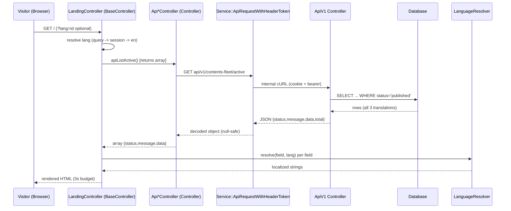
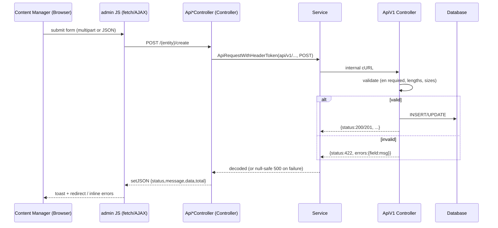
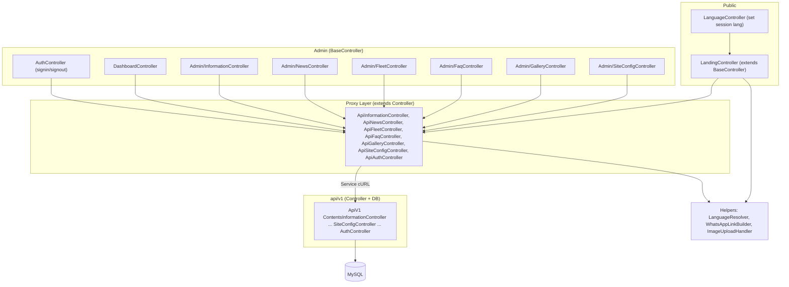
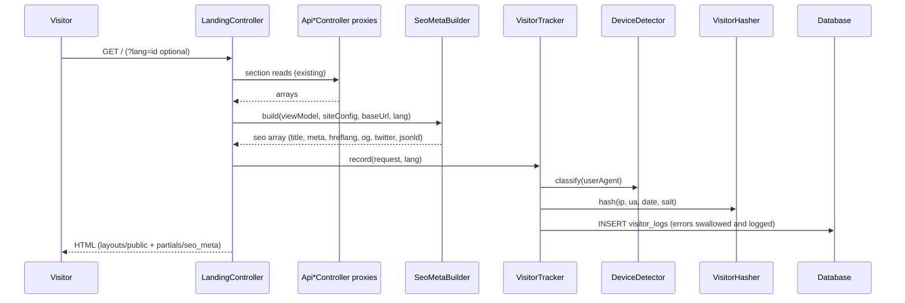
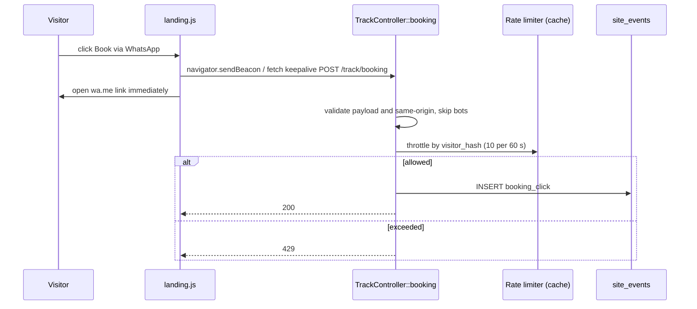
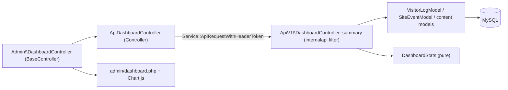

# Design Document

## Overview

The Travel Rental Website is a CodeIgniter 4.7.x (PHP 8.5.x) application with two surfaces:

1. **Public Landing Page** — a single, server-rendered page with hero, about, fleet, gallery, FAQ, news, and contact sections. Content is served in the visitor's selected language (en / id / ms) with fallback to English. Bookings are handled off-site via WhatsApp click-to-chat links.
2. **CMS Admin** — an authenticated back office where a Content Manager authors Information and News content, manages FAQ, Fleet, and gallery items, and edits Site Configuration (section content and the WhatsApp booking number).

The implementation conforms to the workspace CodeIgniter 4 patterns established in the sibling `bimbel-nipasn` project:

- **Three controller tiers.** Public `Page_Controller` and `Admin_Controller` classes extend `BaseController`. `Api*Controller` classes (in `app/Controllers/` root) extend `CodeIgniter\Controller` — never `BaseController` — and act as a **proxy layer** that forwards every content operation to an internal `api/v1/*` endpoint via `Service::ApiRequestWithHeaderToken()`. The `api/v1/*` endpoints (`App\Controllers\ApiV1\*`) own all database access.
- **Why the proxy layer exists.** `BaseController::initController()` runs `authCheck`, builds the menu, and wires `$this->service`. If an `Api*Controller` extended `BaseController` and were instantiated from within another controller, `initController()` would re-run and can recurse — hence the hard rule that `Api*Controller extends Controller`.
- **`Service::ApiRequestWithHeaderToken()`** already handles session cookie forwarding (`CURLOPT_COOKIE`), session lock release (`session_write_close()`), null-safe fallbacks, and JSON validation. The design reuses this verbatim; no new HTTP client is introduced.

### Key Design Decisions

| Decision | Rationale |
| --- | --- |
| Reuse the `Api*Controller` → `api/v1/*` proxy pattern | Required by workspace steering (Req 9). Keeps the codebase consistent with `bimbel-nipasn` and isolates DB access in one tier. |
| Store translations as sibling columns (`title_en`, `title_id`, `title_ms`) rather than a separate translations table | The content set is small and fixed to three languages. Sibling columns keep queries simple, make the "en is mandatory" rule a single `NOT NULL` check, and avoid join overhead on the landing page (Req 1.1 ≤ 3s). |
| Language resolution happens in a view helper / resolver, not in the query | Fallback logic (selected → en → empty string) is a pure, testable function. The DB always returns all three columns; the resolver picks one. This is the core of several correctness properties. |
| Session-based language persistence (`session('lang')`) | Req 2.4 scopes persistence to "the current session". No cookie/DB persistence needed. |
| `status` enum with soft delete (`deleted`) | Matches `bimbel-nipasn` (`whereNotIn('status', ['deleted'])`). Published-only filtering (Req 1.4) and soft delete come for free. |
| WhatsApp link built client-side/server-side from E.164 number | Booking is pure string generation — no integration. Hidden entirely when the number is empty (Req 7.7). |
| Reference look/feel from batamtransportholiday.com | Informs section ordering and visual tone only; no functional dependency. |

## Architecture

### Request Flow — Landing Page (public read)



### Request Flow — CMS Admin (authenticated write via AJAX)



### Layered Component Map



## Components and Interfaces

### 1. Public Page Controllers (`App\Controllers`, extend `BaseController`)

> Note: the public landing page is unauthenticated, so its controller must NOT require login. The `bimbel-nipasn` `BaseController::initController()` calls `requireLogin()` which redirects guests. For this project the public controllers use a **public base** (either a dedicated `PublicBaseController` that performs the global view-data wiring without `requireLogin()`, or the landing routes are excluded from the auth filter). The design uses a `PublicBaseController` to satisfy Req 9.2 ("Page_Controller extends BaseController") in spirit while keeping the landing page open. `PublicBaseController extends CodeIgniter\Controller` and provides `$this->service` and the language resolver; `Admin_Controller` uses the login-guarded `BaseController`.

**`LandingController`**
- `index()` — resolves the active language, calls the Api proxy layer for each section (fleet, information, news, faq, gallery, site config) using the **array-returning** methods, runs each field through `LanguageResolver`, and renders the landing view. Sections that fail to load or are empty render an empty-state/omitted indication without aborting the page (Req 1.7, 1.8, 5.9, 8.5).

**`LanguageController`**
- `set($lang)` — validates `$lang ∈ {en,id,ms}`; if valid, `session()->set('lang', $lang)`; if invalid, leaves the persisted selection unchanged (Req 2.5). Redirects back to the landing page.

### 2. Admin Page Controllers (`App\Controllers\Admin`, extend `BaseController`)

Each follows the `bimbel-nipasn` pattern: declare properties, instantiate only the specific `Api*Controller` in `__construct()`, and render views through `$this->render()`. They do **not** re-wire auth/menu/service/user (Req 9.7).

```php
class InformationController extends BaseController
{
    protected $apiInformation;              // declared (PHP 8.2+, Req 9.6)

    public function __construct()
    {
        $this->apiInformation = new ApiInformationController(); // only this
    }

    public function index()        { /* render list view */ }
    public function contentCreate(){ /* render create form */ }
    public function contentUpdate($id)
    {
        $result = $this->apiInformation->apiShow($id); // array return
        // ...render edit form with $result['data']
    }
}
```

Admin controllers: `AuthController` (signin/signout pages + submit), `DashboardController`, `InformationController`, `NewsController`, `FleetController`, `FaqController`, `GalleryController`, `SiteConfigController`.

### 3. Proxy Layer — `Api*Controller` (`App\Controllers`, extend `Controller`)

One per entity: `ApiInformationController`, `ApiNewsController`, `ApiFleetController`, `ApiFaqController`, `ApiGalleryController`, `ApiSiteConfigController`, `ApiAuthController`.

Rules enforced (Req 9.1, 9.3, 9.4, 9.5, 9.6):
- `extends Controller`, `use ResponseTrait`, declare `protected $service`, instantiate `new Service()` in `__construct()`.
- AJAX-facing methods (`apiList`, `apiCreate`, `apiUpdate`, `apiDelete`, `apiActivate`, ...) **return `$this->response->setJSON([...])`** with the `{status, message, data, total}` shape.
- Methods consumed by a PHP Admin/Page controller (`apiShow`, `apiListActive`, `apiGetConfig`) **return a plain `array`**.
- Every response derives from the null-safe decode produced by `Service::ApiRequestWithHeaderToken()`; on failure the `Service` returns a `{status:500,...}` object and the controller surfaces a non-200 status with an error message (never a thrown error, never a false success — Req 4.7, 5.7, 9.5).

```php
class ApiFleetController extends Controller
{
    use ResponseTrait;
    protected $service;

    public function __construct() { $this->service = new Service(); }

    public function apiList()
    {
        $perPage = $this->request->getGet('per_page') ?? 10;
        $page    = $this->request->getGet('page') ?? 1;
        $UrlApi  = base_url()."api/v1/contents-fleet?per_page={$perPage}&page={$page}";
        $Result  = $this->service->ApiRequestWithHeaderToken($UrlApi, json_encode([]), 'GET');

        $Message = isset($Result->messages) ? ($Result->messages->error ?? $Result->messages) : ($Result->message ?? '');
        $Status  = $Result->status ?? 200;
        $Data    = $Result->data   ?? [];
        $Total   = $Result->total  ?? 0;

        return $this->response->setJSON(['status'=>$Status,'message'=>$Message,'data'=>$Data,'total'=>$Total]);
    }

    public function apiListActive(): array // consumed by LandingController
    {
        $UrlApi = base_url()."api/v1/contents-fleet/active";
        $Result = $this->service->ApiRequestWithHeaderToken($UrlApi, json_encode([]), 'GET');
        return [
            'status'  => $Result->status ?? 200,
            'message' => $Result->message ?? '',
            'data'    => $Result->data ?? [],
        ];
    }

    // apiCreate/apiUpdate forward multipart via Service::ApiRequesUploadWithHeaderToken for images
}
```

Image-bearing operations (Fleet create/update, Gallery upload) use `Service::ApiRequesUploadWithHeaderToken()` so `CURLFile` multipart passes through to `api/v1/*` unchanged.

### 4. api/v1 Endpoints (`App\Controllers\ApiV1`, extend `Controller`)

These own all DB access and all server-side validation. One controller per entity plus `AuthController` and `SiteConfigController`. Each exposes RESTful actions registered under the `api/v1` route group with the internal-proxy/JWT filter (matching `bimbel-nipasn`).

Representative route group:

```php
$routes->group('api/v1', ['namespace' => 'App\Controllers\ApiV1'], function ($routes) {
    $routes->group('contents-information', ['filter' => 'jwt'], function ($routes) {
        $routes->get('/',               'ContentsInformationController::index');
        $routes->get('active',          'ContentsInformationController::getAllActive');
        $routes->get('(:num)',          'ContentsInformationController::show/$1');
        $routes->post('/',              'ContentsInformationController::create');
        $routes->put('(:num)',          'ContentsInformationController::update/$1');
        $routes->delete('(:num)',       'ContentsInformationController::delete/$1');
        $routes->post('activate/(:num)','ContentsInformationController::activate/$1');
        $routes->post('deactivate/(:num)','ContentsInformationController::deactivate/$1');
    });
    // contents-news, contents-fleet, contents-faqs, contents-gallery, site-config, auth ...
});
```

Each `create`/`update` performs server-side validation (Req 2.9, 4.5, 5.5, 6.2, 6.4, 7.3, 8.6) and returns:
- `200`/`201` with `data` on success,
- `422` with a field-keyed `errors` map on validation failure,
- `404` when the referenced id does not exist,
- never persisting on a rejected request.

### 5. Shared Helpers / Libraries

**`LanguageResolver`** (pure function; the heart of the fallback rules)

```php
final class LanguageResolver
{
    public const SUPPORTED = ['en', 'id', 'ms'];
    public const DEFAULT   = 'en';

    /** Normalize an arbitrary request value to a supported language. */
    public static function normalize(?string $lang): string
    {
        return in_array($lang, self::SUPPORTED, true) ? $lang : self::DEFAULT;
    }

    /**
     * Resolve one translatable field.
     * @param array $values ['en'=>..., 'id'=>..., 'ms'=>...]
     */
    public static function resolve(array $values, string $lang): string
    {
        $lang = self::normalize($lang);
        if (isset($values[$lang]) && $values[$lang] !== '' && $values[$lang] !== null) {
            return $values[$lang];
        }
        $fallback = $values[self::DEFAULT] ?? '';
        return $fallback ?? '';
    }
}
```

Rules encoded: Req 2.5 (invalid → en, no persistence change handled by caller), 2.6 (missing selected → en), 2.7 (missing selected and en → empty string, no error).

**`WhatsAppLinkBuilder`** (pure function)

```php
final class WhatsAppLinkBuilder
{
    /** E.164: leading '+', 8–15 digits total. */
    public static function isValidNumber(?string $raw): bool
    {
        return is_string($raw) && preg_match('/^\+\d{8,15}$/', $raw) === 1;
    }

    /** Returns null when no valid number is configured (booking hidden, Req 7.7). */
    public static function build(?string $number, string $prefill = ''): ?string
    {
        if (!self::isValidNumber($number)) return null;
        $digits = ltrim($number, '+');                 // wa.me wants digits only
        $msg    = mb_substr($prefill, 0, 200);          // Req 7.6 cap
        $query  = $msg !== '' ? '?text=' . rawurlencode($msg) : '';
        return "https://wa.me/{$digits}{$query}";
    }
}
```

**`ImageUploadHandler`** — validates type (JPEG/PNG/WebP) and size (≤ 5 MB) before accepting an upload (Req 6.7–6.9). Lives in the `api/v1` tier since that is where persistence happens; the proxy simply forwards the multipart body. Rejected uploads leave the existing record unchanged.

## Data Models

### Translation Strategy

Every translatable field is stored as three sibling columns suffixed `_en`, `_id`, `_ms`. The `_en` column is `NOT NULL` and non-empty by validation (the default-language guarantee, Req 2.9, 4.1, 5.1, 8.1, 8.6). `_id` and `_ms` are nullable; when absent at read time, `LanguageResolver` falls back to `_en`, and if `_en` is empty it yields an empty string (Req 2.6, 2.7).

### Entity: `c_information`

| Column | Type | Notes |
| --- | --- | --- |
| `id` | BIGINT PK AUTO_INCREMENT | |
| `title_en` / `title_id` / `title_ms` | VARCHAR(255) | `title_en` required |
| `body_en` / `body_id` / `body_ms` | TEXT | ≤ 5000 chars/field; `body_en` required |
| `status` | ENUM('draft','published','deleted') | default `draft`; landing shows `published` |
| `created_at`/`updated_at`/`deleted_at` | DATETIME | soft delete |

### Entity: `c_news`

| Column | Type | Notes |
| --- | --- | --- |
| `id` | BIGINT PK | |
| `title_en`/`title_id`/`title_ms` | VARCHAR(200) | 1–200 chars; `title_en` required |
| `body_en`/`body_id`/`body_ms` | MEDIUMTEXT | 1–20000 chars; `body_en` required |
| `publish_date` | DATETIME | set on create; landing shows rows with `publish_date <= NOW()` ordered DESC (Req 5.2, 5.8) |
| `status` | ENUM('draft','published','deleted') | |
| timestamps | DATETIME | |

### Entity: `c_fleet`

| Column | Type | Notes |
| --- | --- | --- |
| `id` | BIGINT PK | |
| `name_en`/`name_id`/`name_ms` | VARCHAR(200) | `name_en` required; name used in WhatsApp prefill (≤200) |
| `description_en`/`description_id`/`description_ms` | TEXT | ≤ 5000 chars |
| `image_path` | VARCHAR(500) NULL | placeholder used when NULL (Req 1.6) |
| `status` | ENUM('draft','published','deleted') | |
| timestamps | DATETIME | |

### Entity: `c_faqs`

| Column | Type | Notes |
| --- | --- | --- |
| `id` | BIGINT PK | |
| `question_en`/`question_id`/`question_ms` | VARCHAR(500) | 1–500; `question_en` required |
| `answer_en`/`answer_id`/`answer_ms` | TEXT | 1–5000; `answer_en` required |
| `status` | ENUM('draft','published','deleted') | |
| timestamps | DATETIME | |

### Entity: `c_gallery`

| Column | Type | Notes |
| --- | --- | --- |
| `id` | BIGINT PK | |
| `caption_en`/`caption_id`/`caption_ms` | VARCHAR(255) NULL | optional caption |
| `image_path` | VARCHAR(500) | required (gallery item is an image) |
| `sort_order` | INT | display order |
| `status` | ENUM('draft','published','deleted') | |
| timestamps | DATETIME | |

### Entity: `site_config` (section content + settings)

Single-row or key/value configuration. Section content (hero, about, gallery intro, contact) is translatable and must be saved for all three languages together (Req 6.3, 6.4).

| Column | Type | Notes |
| --- | --- | --- |
| `id` | BIGINT PK | single active row |
| `hero_title_en/_id/_ms` | VARCHAR(255) | all three required on save |
| `hero_subtitle_en/_id/_ms` | VARCHAR(500) | |
| `about_body_en/_id/_ms` | TEXT | |
| `contact_body_en/_id/_ms` | TEXT | |
| `contact_email` | VARCHAR(255) | non-translatable |
| `contact_address` | VARCHAR(500) | non-translatable |
| `whatsapp_number` | VARCHAR(16) | E.164 `^\+\d{8,15}$` or empty (Req 7.1–7.4) |
| timestamps | DATETIME | |

### Entity: `admin_users` (CMS authentication)

| Column | Type | Notes |
| --- | --- | --- |
| `id` | BIGINT PK | |
| `username` | VARCHAR(100) UNIQUE | |
| `password_hash` | VARCHAR(255) | `password_hash()` bcrypt/argon |
| `status` | ENUM('active','inactive') | only `active` may sign in (Req 3.2) |
| `failed_attempts` | INT default 0 | lockout counter (Req 3.5) |
| `locked_until` | DATETIME NULL | 15-min lockout window |
| `last_login_at` | DATETIME NULL | |
| timestamps | DATETIME | |

### Models (`App\Models`, extend `CodeIgniter\Model`)

`InformationModel` (`c_information`), `NewsModel` (`c_news`), `FleetModel` (`c_fleet`), `FaqModel` (`c_faqs`), `GalleryModel` (`c_gallery`), `SiteConfigModel` (`site_config`), `AdminUserModel` (`admin_users`). Each declares `$table`, `$primaryKey`, and `$allowedFields` listing every translation column plus status/timestamps (mirroring `ContentsFaqsModel`).

### Authentication & Session Model

- **Sign-in** (Req 3.2, 3.3): `api/v1/auth/login` verifies username + `password_verify()` against an `active` account. On success the Admin `AuthController` establishes a session (CI session with 30-minute inactivity timeout configured via `Config\Session` / `App.sessionExpiration`). Generic error message on failure — never reveals which field was wrong.
- **Lockout** (Req 3.5): on each failed attempt increment `failed_attempts`; at ≥ 5 within 15 minutes set `locked_until = now + 15min` and reject with a lockout message until it expires.
- **Inactivity** (Req 3.6): a 30-minute idle session is treated as unauthenticated; the auth filter redirects to sign-in.
- **Guard** (Req 3.1): an `admin` route filter redirects unauthenticated requests for any admin page (except sign-in) to the sign-in page without rendering the protected content.
- **Sign-out** (Req 3.4): destroys the session and redirects to sign-in.

## Correctness Properties

*A property is a characteristic or behavior that should hold true across all valid executions of a system — essentially, a formal statement about what the system should do. Properties serve as the bridge between human-readable specifications and machine-verifiable correctness guarantees.*

The properties below were derived from the acceptance criteria. Pure logic (language resolution, WhatsApp link building, validation rules, filtering/ordering, pagination, and the proxy null-safe mapping) is covered by property-based tests. Infrastructure, auth/session timing, performance budgets, architectural structure, and simple CRUD side effects are covered by example/integration tests instead (see Testing Strategy).

### Property 1: Selected-language resolution

*For any* translatable field whose value map contains a non-empty value for a selected supported language (en, id, or ms), `LanguageResolver::resolve` SHALL return that selected-language value.

**Validates: Requirements 1.2, 2.3**

### Property 2: Resolver fallback chain and normalization

*For any* language input and any field value map: (a) `normalize` SHALL return `en` when the input is absent, null, or not one of {en, id, ms}, and otherwise the input unchanged; and (b) `resolve` SHALL return the selected-language value when non-empty, else the `en` value when non-empty, else the empty string, and SHALL never raise an error.

**Validates: Requirements 1.3, 2.2, 2.6, 2.7**

### Property 3: Invalid language preserves persisted selection

*For any* previously persisted valid language L and *for any* request language value that is not a supported language, the active render language SHALL be `en` and the persisted session selection SHALL remain exactly L (unchanged); and *for any* valid language, setting then reading the persisted selection SHALL return that same language.

**Validates: Requirements 2.4, 2.5**

### Property 4: Published-items filter excludes non-published

*For any* collection of Information, News, or Fleet items with arbitrary status values, the landing-page dataset SHALL contain exactly those items whose status is `published` and SHALL exclude every item with any other status.

**Validates: Requirements 1.4, 4.8, 8.4**

### Property 5: Fleet image-source selection and list totality

*For any* list of Fleet items, the rendered image-source list SHALL have the same length as the input list (no item dropped), and each entry SHALL be the item's own image when its image reference is non-empty and the placeholder image otherwise.

**Validates: Requirements 1.5, 1.6, 1.8**

### Property 6: Required-field (mandatory-en) rejection

*For any* content record (Information, News, FAQ, or translatable config section) in which at least one required field is missing or empty in the default language (en), the create/update operation SHALL be rejected with status 422, SHALL name each missing required field, and SHALL leave any previously stored record unchanged.

**Validates: Requirements 2.9, 4.5, 5.5, 8.6**

### Property 7: Field-length validation

*For any* content record, the operation SHALL be accepted only if every required translatable field, in each of en/id/ms, has a length within that entity's permitted range (Information/FAQ answer ≤ 5000; News title ≤ 200; News body ≤ 20000; FAQ question ≤ 500), and SHALL be rejected with status 422 naming each out-of-range field otherwise.

**Validates: Requirements 2.8, 4.1, 4.3, 5.1, 5.3, 8.1**

### Property 8: Pagination metadata consistency

*For any* dataset and *for any* requested page and per_page where per_page is within 1..100 (defaulting to 10 when unset), the returned list length SHALL not exceed per_page, the reported total SHALL equal the dataset size, the current page SHALL equal the requested page (minimum 1), and the returned page SHALL be the corresponding slice of the ordered dataset.

**Validates: Requirements 4.2, 5.2**

### Property 9: News published filtering and descending order

*For any* collection of News items with arbitrary publish dates and statuses, the landing-page news output SHALL contain only items that are published with a publish date on or before the current timestamp, and the output SHALL be ordered by publish date in non-increasing (descending) order.

**Validates: Requirements 5.2, 5.8**

### Property 10: Proxy null-safe failure mapping

*For any* upstream response returned by `Service::ApiRequestWithHeaderToken` that represents a failure (null, empty, non-JSON, or a non-200 status object), the `Api*Controller` method SHALL produce a response whose status is not 200 and whose message indicates the upstream request failed, and SHALL never report the operation as successful nor raise an unhandled error.

**Validates: Requirements 4.7, 5.7, 9.5**

### Property 11: Site-config invalid-field rejection retains previous configuration

*For any* previously persisted valid Site_Configuration and *for any* submitted configuration with one or more required fields missing or invalid, the operation SHALL be rejected with a validation error naming each invalid field, and the stored configuration SHALL remain identical to the previously persisted configuration.

**Validates: Requirements 6.2**

### Property 12: Section-content all-languages save round trip

*For any* section (hero, about, gallery, contact) content provided with a value for all three supported languages (en, id, ms), saving then reading back the section SHALL return the same three values for that section.

**Validates: Requirements 6.3**

### Property 13: Section-content language completeness rejection

*For any* section-content update that provides values for fewer than all three supported languages (en, id, ms), the operation SHALL be rejected with a validation error that names exactly the languages whose content is missing.

**Validates: Requirements 6.4**

### Property 14: Image upload validation

*For any* uploaded file, the upload SHALL be accepted if and only if its type is an allowed image type (JPEG, PNG, or WebP) and its size does not exceed 5 megabytes; on rejection the existing record SHALL remain unchanged and the validation error SHALL identify the violated constraint (allowed types, or the 5 MB maximum).

**Validates: Requirements 6.7, 6.8, 6.9**

### Property 15: WhatsApp number E.164 validation with retain-previous

*For any* string, `WhatsAppLinkBuilder::isValidNumber` SHALL return true if and only if the string matches `^\+\d{8,15}$`; and *for any* previously stored WhatsApp number, submitting a value that fails validation SHALL be rejected and SHALL leave the stored number unchanged, while a value that passes SHALL be persisted and retrievable unchanged.

**Validates: Requirements 7.1, 7.2, 7.3**

### Property 16: WhatsApp link generation and booking visibility

*For any* WhatsApp number and *for any* prefill text: when the number is valid, `WhatsAppLinkBuilder::build` SHALL return a `https://wa.me/<digits>` URL whose digits equal the number without its leading plus and whose decoded `text` parameter equals the prefill truncated to at most 200 characters; and when the number is invalid or empty it SHALL return null, so the booking action is shown if and only if the configured number is valid.

**Validates: Requirements 7.5, 7.6, 7.7**

## Error Handling

### Landing page (graceful degradation)
- Section data retrieved through the proxy layer is always read with null-safe accessors (`$result['data'] ?? []`). If an upstream call fails or returns empty for a required section, that section renders an "unavailable"/empty-state indication and the rest of the page still renders with a 200 (Req 1.7, 1.8, 5.9, 8.5). The landing page never surfaces a 500 due to a single missing section.
- Missing translations degrade through `LanguageResolver` (selected → en → empty string) rather than erroring (Req 2.6, 2.7).

### Proxy layer (`Api*Controller`)
- All responses flow from `Service::ApiRequestWithHeaderToken`, which already returns a `{status:500,...}` object on cURL error, empty body, non-JSON, or JSON decode error. The controller maps these with `$Result->status ?? 200` / `?? []` null-safe reads and returns a non-200 status with a failure message — never a thrown exception and never a false success (Req 4.7, 5.7, 9.5).

### api/v1 layer (validation and not-found)
- Validation failures return `422` with a field-keyed error map; nothing is persisted (Req 2.9, 4.5, 5.5, 6.2, 6.4, 7.3, 8.6).
- References to non-existent ids return `404` with no write (Req 4.6, 5.6, 8.3).
- Image uploads that fail type/size checks return a validation error and leave the existing record untouched (Req 6.8, 6.9).

### Authentication
- Failed sign-in returns a single generic message that does not reveal which field was wrong (Req 3.3).
- Five or more failed attempts within 15 minutes lock the username for 15 minutes with a lockout message (Req 3.5).
- Expired/inactive sessions and unauthenticated access redirect to sign-in without exposing protected content (Req 3.1, 3.6).

## Testing Strategy

### Property-Based Testing

PBT **is appropriate** for this feature's pure logic: language resolution/fallback, WhatsApp E.164 validation and link building, field validation (required/length/image), published filtering, news ordering, pagination metadata, and the proxy null-safe mapping. Each of these has a meaningful "for all inputs X, property P(X) holds" statement and is cheap to run many times.

- **Library:** use a PHP property-based testing library (**Eris** for PHPUnit, e.g. `giorgiosironi/eris`). Do **not** hand-roll property generation.
- **Iterations:** each property test runs a **minimum of 100 iterations**.
- **Traceability:** each property test carries a comment tag in the form
  `// Feature: travel-rental-website, Property {number}: {property_text}`
  and references the design property it implements. Each of Properties 1–16 is implemented by exactly one property-based test.
- **Mapping:** P1–P3 and P16 target `LanguageResolver` / `WhatsAppLinkBuilder` (fully pure). P4, P5, P9 target the filter/selection/ordering functions on in-memory data. P6, P7, P13, P14, P15 target the validation functions in the `api/v1` layer (pure validators, no DB). P8 targets the pagination slice/metadata function. P10 targets the proxy response-mapping function with a stubbed `Service`. P11, P12, P15(persistence) target the config/number save path using an in-memory or transactional test double so round-trips do not hit production storage.

### Example-Based Unit Tests

Use example tests for specific, non-input-varying behaviors and contracts:
- Language selector renders exactly the three options en/id/ms (Req 2.1).
- Empty WhatsApp number saves successfully and disables booking (Req 7.4).
- CRUD happy-path response contracts: create returns id + status (Req 4.1, 6.1, 6.5, 6.6, 8.1), delete returns 200 (Req 4.4, 5.4, 8.2).
- Not-found returns 404 (Req 4.6, 5.6, 8.3).
- Proxy response-shape contract: AJAX methods return JSON with `status/message/data/total` (Req 9.3); PHP-consumed methods return an array (Req 9.4).
- Empty-state rendering for sections with no published items (Req 1.8, 5.9, 8.5).

### Integration Tests

- Landing page renders all sections end-to-end within the 3-second budget (Req 1.1), and a configured valid number produces a working wa.me link (Req 7.5 timing).
- Site_Configuration save completes within 5 seconds (Req 6.1).
- Auth flow: valid active credentials establish a 30-minute-inactivity session and redirect to the dashboard (Req 3.2); sign-out terminates the session (Req 3.4); unauthenticated admin access redirects to sign-in (Req 3.1); inactivity ≥ 30 minutes de-authenticates (Req 3.6).
- Lockout boundary: four failed attempts do not lock, the fifth locks for 15 minutes (Req 3.5).

### Architectural Conformance Tests (reflection/static)

- Every `Api*Controller` extends `CodeIgniter\Controller`, not `BaseController` (Req 9.1).
- Page/Admin controllers extend `BaseController` (Req 9.2).
- Each controller declares every property assigned in its constructor (Req 9.6), and Admin controllers do not re-initialize authCheck/menu/service/user (Req 9.7) — verified by reflection plus code review.

### Test Balance

Property tests carry the burden of input-space coverage for the pure logic; unit tests pin concrete contracts and edge cases; integration tests verify wiring, timing, auth/session, and persistence. Avoid over-writing unit tests for behavior already covered by a property.

---

# Extension: Bootstrap UI, SEO, and Visitor Analytics (Requirements 10–12)

This section extends the design above. Nothing in the sections above is replaced. The existing three-tier pattern (`Page/Admin → Api*Controller → api/v1 → DB`), the existing view-model keys, element ids, routes, `admin.js` contracts, and the existing tests remain the compatibility baseline.

## Overview (Extension)

Three additions are made to the implemented application:

1. **Bootstrap UI (Req 10).** The Landing_Page, CMS_Admin, and Sign_In_Page are redesigned with Bootstrap 5.3 and Bootstrap Icons, served from `public/assets/vendor` with no runtime CDN. The landing hero becomes a carousel built from published gallery images.
2. **SEO (Req 11).** A pure `SeoMetaBuilder` produces all head metadata and JSON-LD. `robots.txt` and `sitemap.xml` routes are added. SEO fields become part of Site_Configuration through a new migration.
3. **Analytics and dashboard (Req 12).** Landing visits and WhatsApp booking clicks are recorded in two new tables using privacy-preserving hashes. The admin Dashboard shows aggregated metrics rendered with Chart.js.

### Extension Design Decisions

| Decision | Rationale |
| --- | --- |
| Vendor assets downloaded once from jsDelivr into `public/assets/vendor` and committed | Removes the runtime CDN dependency (Req 10.2) and keeps pages working offline in the dev environment. |
| Two layouts, `layouts/public.php` and the rewritten `admin/layout.php`, with `partials/seo_meta.php` | Centralizes head markup. The existing `landing/index` and admin views keep their view-model and `$this->extend/section` style so existing tests still load them. |
| `SeoMetaBuilder`, `DeviceDetector`, `VisitorHasher`, `DashboardStats` are pure classes in `app/Libraries` | They need no DB or HTTP, so they are unit and property testable (Req 12.28). |
| Visitor hash includes the date and an app-key salt and the raw IP is never stored | Provides daily-unique counting without storing personal data (Req 12.2–12.4). Because the hash rotates daily, "unique visitors over 7/30 days" counts distinct (date, hash) pairs, so a returning visitor is counted once per day. This is documented on the dashboard. |
| Bots are logged with `is_bot = 1` but excluded in every aggregate | Keeps raw evidence for debugging while satisfying Req 12.6. Aggregation filters `is_bot = 0` in SQL and `DashboardStats` also filters defensively. |
| `POST /track/booking` is outside the CSRF filter and outside the admin filter, protected by payload validation, a same-origin check, and a per-`visitor_hash` rate limit | Landing pages are cached by browsers and have no session CSRF token requirement; abuse is bounded by the limiter (Req 12.10–12.13). |
| Dashboard data comes from a single `api/v1/dashboard/summary` call | One cURL round trip per dashboard load; the controller stays within the 3-tier pattern (Req 12.14, 12.15). |
| Chart.js is initialised from JSON embedded in the page (`<script type="application/json">`) | Avoids inline script data injection and extra AJAX; a JSON refresh route is also available. |

## Architecture (Extension)

### Landing Request with Tracking and SEO



### Booking Click Tracking



### Dashboard Data Flow



### Asset and View Layout

```text
public/assets/
  vendor/
    bootstrap/        css/bootstrap.min.css, js/bootstrap.bundle.min.js
    bootstrap-icons/  font/bootstrap-icons.min.css, font/fonts/*
    chartjs/          chart.umd.min.js
  css/ landing.css, admin.css
  js/  landing.js, admin.js (existing contracts preserved), dashboard.js
  img/ og-default.jpg
app/Views/
  layouts/public.php           (new: head via partials/seo_meta, navbar, footer, floating WhatsApp)
  partials/seo_meta.php        (new: renders SeoMetaBuilder output)
  landing/index.php            (redesigned, extends layouts/public)
  admin/layout.php             (rewritten: sidebar + offcanvas, toast container, noindex)
  admin/signin.php             (redesigned, noindex)
  admin/dashboard.php          (rewritten)
```

## Components and Interfaces (Extension)

### 1. Vendor Assets

Bootstrap, Bootstrap Icons, and Chart.js release files are downloaded from jsDelivr during implementation (for example `https://cdn.jsdelivr.net/npm/bootstrap@5.3.x/dist/...`) with exact pinned versions and stored in the paths above. A `public/assets/vendor/README.md` records versions and source URLs. Views reference them through `base_url('assets/vendor/...')`.

### 2. Public Layout and Landing View

`layouts/public.php` provides: `<html lang="{lang}">`, viewport meta, `partials/seo_meta`, local CSS, a navbar with `navbar-expand-lg` and toggler, a language dropdown, `<main>` yielding the page sections, `<footer>`, a floating WhatsApp button, and the local JS bundle.

The language dropdown keeps the markup contract asserted by the existing `LandingViewTest`. It renders `<ul class="lang-selector dropdown-menu">`-style markup whose links are exactly `lang/en`, `lang/id`, `lang/ms`. If the contract must change to a dropdown, the test is updated to match the new class list while keeping its intent (exactly three links, one per supported language).

Landing sections:

| Section | Markup |
| --- | --- |
| Hero | `#hero` Bootstrap carousel (`carousel slide carousel-fade`, `data-bs-ride="carousel"`, `data-bs-interval="5000"`, `data-bs-pause="hover"`, `data-bs-keyboard="true"`) with indicators and prev/next controls when slides > 1. Static hero when no gallery images. The single `h1` is the hero title. |
| About | `#about` two-column grid |
| Fleet | `#fleet` `row row-cols-1 row-cols-sm-2 row-cols-lg-3` of cards, each with `loading="lazy"` image and booking button |
| Information / News | cards and list group |
| Gallery | `#gallery` responsive thumbnail grid |
| FAQ | `#faq` Bootstrap accordion |
| Contact | `#contact` with email, address, WhatsApp |

Carousel slides use gallery items already in the view-model (`gallery`), capped at 5 via `array_slice`. A small `landing.js` listener applies `prefers-reduced-motion` by setting `data-bs-ride="false"` and removing the transition class. It also sends the booking click beacon from elements marked `data-track-booking`, `data-fleet-id`, `data-fleet-name`.

`LandingController::index()` additionally supplies `seo` (output of `SeoMetaBuilder`), `heroSlides` (derived list), and `trackBookingUrl`. Existing view-model keys remain unchanged.

### 3. Admin Layout, Views, and Sign-In

`admin/layout.php` is rewritten with a fixed sidebar (`offcanvas-lg offcanvas-start`) that collapses below 992 px, a top bar with a toggle button, a toast container (`.toast-container`), and `<meta name="robots" content="noindex, nofollow">`. List views keep `partials/list_table.php` but wrap tables in `.table-responsive`. Form partials add `.invalid-feedback` blocks that `admin.js` fills from 422 responses. Existing element ids, `data-*` attributes, EN/ID/MS tab structure, and CSRF handling are preserved. `signin.php` becomes a centered Bootstrap card with labelled inputs and `noindex`. The Site Configuration page gains an **SEO** tab containing SEO_Settings fields.

### 4. SeoMetaBuilder (`app/Libraries/SeoMetaBuilder.php`, pure)

```php
final class SeoMetaBuilder
{
    public const SUPPORTED = ['en', 'id', 'ms'];
    public const DESCRIPTION_MAX = 160;

    /**
     * @param array<string,mixed> $model   landing view-model (hero, about, fleet, faq, gallery, contact, ...)
     * @param array<string,mixed> $config  site_config row including SEO fields
     * @return array{
     *   title:string, description:string, keywords:?string, robots:string, canonical:string,
     *   alternates: list<array{hreflang:string, href:string}>,
     *   og: array<string,string>, twitter: array<string,string>, jsonld: list<array<string,mixed>>
     * }
     */
    public static function build(array $model, array $config, string $baseUrl, string $lang): array;

    public static function truncate(string $text, int $max = self::DESCRIPTION_MAX): string; // multibyte-safe, no trailing partial word required
    public static function alternates(string $baseUrl): array;   // en, id, ms, x-default
    public static function jsonLd(array $model, array $config, string $baseUrl, string $lang): array;
    public static function encodeJsonLd(array $blocks): string;  // JSON_UNESCAPED_UNICODE|JSON_UNESCAPED_SLASHES|JSON_HEX_TAG|JSON_HEX_AMP
}
```

Rules:
- Title: `{hero title or site name} | {site name}` resolved with `LanguageResolver`; falls back to site name then to a default string.
- Description: SEO meta description in the selected language, then English, then hero subtitle, then about text; truncated to 160 characters.
- Canonical: `rtrim($baseUrl, '/') . '/'` plus `?lang={lang}` for non-default languages. Alternates use the same form for `en`, `id`, `ms`, with `x-default` pointing to the English URL.
- `og:locale` maps `en → en_US`, `id → id_ID`, `ms → ms_MY`; `og:image` follows Req 11.7 and is always absolute.
- JSON-LD: an `AutoRental` block; a `FAQPage` block only if FAQ items are present. `encodeJsonLd` uses `JSON_HEX_TAG` so a `</script>` in content cannot break out of the script element.

`partials/seo_meta.php` outputs every value through `esc()` with the right context (`html` for text, `attr` for attributes, `url` for URLs); JSON-LD is emitted raw from `encodeJsonLd` because it is already JSON and hex-escaped.

### 5. Robots and Sitemap (`App\Controllers\SeoController`, extends `PublicBaseController`)

- `robots()` returns `text/plain`: `User-agent: *`, `Allow: /`, `Disallow: /admin`, `/signin`, `/api`, `/dashboard`, and `Sitemap: {base}/sitemap.xml`.
- `sitemap()` returns `application/xml` with the landing URL and `xhtml:link rel="alternate"` entries for `en`, `id`, `ms` and `x-default`, with `lastmod` from the newest content update when available.
- Routes: `GET robots.txt`, `GET sitemap.xml`, both outside the admin filter.

### 6. SEO Settings in Site Configuration

New `site_config` columns (new migration, idempotent via `fieldExists` checks):

| Column | Type | Notes |
| --- | --- | --- |
| `site_name_en` / `_id` / `_ms` | VARCHAR(150) NULL | `site_name_en` required when any SEO value is provided |
| `meta_description_en` / `_id` / `_ms` | VARCHAR(320) NULL | max 320; truncated to 160 for the tag |
| `meta_keywords_en` / `_id` / `_ms` | VARCHAR(255) NULL | optional |
| `og_image` | VARCHAR(500) NULL | uploaded path or absolute path/URL |

`SiteConfigModel::$allowedFields` is extended. `ContentValidator::validateSeoSettings()` (new, pure) enforces the length rules and the English requirement and `SiteConfigController::prepareSave` merges it with the existing section validation and the existing `ImageUploadHandler` check for the OG image upload. A rejected save leaves the stored row untouched (Req 11.19). `ApiSiteConfigController::apiSave` forwards the OG image as multipart through `ApiRequesUploadWithHeaderToken` like fleet images.

### 7. Visitor Analytics Components

**`DeviceDetector` (pure)**

```php
final class DeviceDetector
{
    public const DESKTOP = 'desktop'; public const MOBILE = 'mobile';
    public const TABLET = 'tablet';   public const BOT = 'bot';

    public static function classify(?string $userAgent): string; // always one of the four constants
    public static function isBot(?string $userAgent): bool;
}
```

Order of checks: empty/whitespace UA → `bot`; bot signatures (`bot`, `crawl`, `spider`, `slurp`, `curl`, `wget`, `python-requests`, `headless`, `facebookexternalhit`, `lighthouse`, and similar) → `bot`; tablet signatures (`ipad`, `tablet`, Android without `mobile`) → `tablet`; mobile signatures (`mobi`, `iphone`, `android`) → `mobile`; otherwise `desktop`.

**`VisitorHasher` (pure)**

```php
final class VisitorHasher
{
    public static function hash(string $ip, string $userAgent, string $date, string $salt): string; // hash('sha256', implode('|', [...]))
}
```

Output is a 64-character lowercase hex string. The salt is derived from `encryption.key` (for example `hash('sha256', 'visitor-salt|' . $key)`) by `VisitorTracker`, not by the pure class.

**`VisitorTracker` (`app/Libraries/VisitorTracker.php`)** takes the request, selected language, a model, and a clock. `shouldTrack(string $path): bool` rejects excluded prefixes (Req 12.7). `record()` builds the row (`referrer_host` is the parsed host of the `Referer` header, null when absent or equal to the site's own host), inserts through `VisitorLogModel`, and wraps everything in `try/catch (\Throwable)`. On failure it calls `log_message('error', ...)` with a message that contains no IP address. `LandingController::index()` calls the tracker after building the response data, so a tracker failure cannot alter the page.

**`TrackController::booking` (`App\Controllers\TrackController`, extends `PublicBaseController`)** reads JSON or form fields `fleet_id`, `fleet_name`, `lang`. It rejects bots (returns 204 with no insert), validates with `ContentValidator::validateBookingClick()` (pure: numeric positive id, name 1–200 chars, lang in supported set), checks that `Origin`/`Referer` host equals the site host when present, applies the rate limiter, and inserts via `SiteEventModel`. The route is registered as `POST track/booking` with no `admin` or `internalapi` filter.

Rate limiting uses the CodeIgniter cache: key `track_booking_{visitor_hash}`, counter incremented with a 60-second TTL, limit 10.

### 8. Dashboard Components

**`DashboardStats` (pure)**

```php
final class DashboardStats
{
    /** @param array<string,int> $countsByDate 'Y-m-d' => count @return list<array{date:string,count:int}> exactly $days entries, ascending, ending $endDate */
    public static function fillDateRange(array $countsByDate, string $endDate, int $days = 30): array;

    /** @param array<string,int> $counts @return array<string,array{count:int,percent:float}> percentages rounded to 1 decimal, adjusted so the sum is 100.0 when total > 0, all 0.0 when total = 0 */
    public static function distribution(array $counts, array $keys): array;

    /** @param list<array<string,mixed>> $rows visitor_logs rows @return list<array<string,mixed>> rows with is_bot falsy */
    public static function excludeBots(array $rows): array;

    /** @return array{unique_today:int, unique_7d:int, unique_30d:int, total:int, page_views:int} */
    public static function visitorTotals(array $rows, string $today): array;

    /** @param array<string,int> $counts @return list<array{label:string,count:int}> descending by count, ties alphabetical, limited to $limit */
    public static function topN(array $counts, int $limit = 5): array;
}
```

Percentage rounding uses the largest-remainder method so the rounded values always sum to exactly 100.0 (Req 12.19). Because the daily-rotating hash makes cross-day identity impossible, unique counts for 7 and 30 days count distinct `(visit_date, visitor_hash)` pairs.

**`ApiV1\DashboardController::summary`** (route `GET api/v1/dashboard/summary`, `internalapi` filter) reads `visitor_logs` (non-bot rows for the trailing 30 days plus all-time totals via SQL aggregates), `site_events`, content tables (`published`/`draft` counts per entity, excluding `deleted`), the latest 5 published or draft News_Items, the max `admin_users.last_login_at`, and the configured WhatsApp number. It feeds `DashboardStats` and returns:

```json
{
  "status": 200, "message": "OK", "total": 0,
  "data": {
    "visitors": {"total":0,"unique_today":0,"unique_7d":0,"unique_30d":0,"page_views":0},
    "daily": [{"date":"2025-01-01","page_views":0,"unique":0}],
    "languages": {"en":{"count":0,"percent":0.0},"id":{...},"ms":{...}},
    "devices": {"desktop":{...},"mobile":{...},"tablet":{...}},
    "referrers": [{"label":"google.com","count":0}],
    "bookings": {"total":0,"last_7d":0,"last_30d":0,"top_fleet":[{"label":"Alphard","count":0}]},
    "content": {"fleet":{"published":0,"draft":0},"news":{...},"information":{...},"faq":{...},"gallery":{...}},
    "latest_news": [{"id":1,"title":"...","publish_date":"..."}],
    "last_admin_login": null,
    "whatsapp_configured": false
  }
}
```

**`ApiDashboardController` (extends `Controller`)** declares `protected $service`, and exposes `apiSummary(): array` (consumed by `Admin\DashboardController`) and `apiSummaryJson()` (AJAX refresh at `GET admin/api/dashboard/summary`, behind the `admin` filter). Null-safe fallbacks return an all-zero summary with a non-200 status and an error message on upstream failure.

**`Admin\DashboardController::index`** instantiates only `ApiDashboardController`, passes the summary to `admin/dashboard.php`. The view renders Bootstrap cards, a `canvas` per chart, the JSON data block, and an alert card when `whatsapp_configured` is false. `public/assets/js/dashboard.js` creates the Chart.js charts and shows an empty-state message when a dataset has only zeros.

### 9. Routes Added

```php
// Public
$routes->get('robots.txt', 'SeoController::robots');
$routes->get('sitemap.xml', 'SeoController::sitemap');
$routes->post('track/booking', 'TrackController::booking');

// Admin AJAX (inside the existing admin/api group)
$routes->get('dashboard/summary', 'ApiDashboardController::apiSummaryJson');

// api/v1 (inside the existing api/v1 group)
$routes->get('dashboard/summary', 'DashboardController::summary', ['filter' => 'internalapi']);
```

## Data Models (Extension)

### Table: `visitor_logs`

| Column | Type | Notes |
| --- | --- | --- |
| `id` | BIGINT UNSIGNED PK AUTO_INCREMENT | |
| `visit_date` | DATE NOT NULL | |
| `visitor_hash` | CHAR(64) NOT NULL | SHA-256 hex; no raw IP |
| `page` | VARCHAR(255) NOT NULL | normalized path, default `/` |
| `lang` | CHAR(2) NOT NULL | `en`, `id`, or `ms` |
| `device_type` | ENUM('desktop','mobile','tablet','bot') NOT NULL | |
| `referrer_host` | VARCHAR(255) NULL | host only |
| `is_bot` | TINYINT(1) NOT NULL DEFAULT 0 | |
| `created_at` | DATETIME NOT NULL | |

Indexes: `idx_visitor_logs_visit_date (visit_date)`, `idx_visitor_logs_visitor_hash (visitor_hash)`.

### Table: `site_events`

| Column | Type | Notes |
| --- | --- | --- |
| `id` | BIGINT UNSIGNED PK AUTO_INCREMENT | |
| `event_type` | VARCHAR(50) NOT NULL | `booking_click` |
| `ref_id` | INT UNSIGNED NULL | Fleet_Item id |
| `ref_label` | VARCHAR(200) NULL | Fleet_Item name |
| `lang` | CHAR(2) NOT NULL | |
| `visitor_hash` | CHAR(64) NOT NULL | |
| `created_at` | DATETIME NOT NULL | |

Indexes: `idx_site_events_type_created (event_type, created_at)`, `idx_site_events_ref (ref_id)`.

### Migrations and Schema

Three new migrations are added without touching existing ones: `AddSeoColumnsToSiteConfig`, `CreateVisitorLogs`, `CreateSiteEvents`. Each is idempotent: `createTable(..., true)` for new tables, and `fieldExists()` guards around each `addColumn` for `site_config`. `down()` drops only what `up()` created. `database/schema.sql` receives the same DDL with `CREATE TABLE IF NOT EXISTS` and guarded column additions. Because the original tables were created from `schema.sql`, the `migrations` table may be out of sync, so idempotence is required for `php spark migrate` to succeed against the local database (`127.0.0.1:3307`, `tour_travel`).

### Models

`VisitorLogModel` (`visitor_logs`) and `SiteEventModel` (`site_events`) declare `$table`, `$primaryKey`, `$allowedFields`, `$useTimestamps = false` (the tracker sets `created_at` itself), and `$returnType = 'array'`. `SiteConfigModel::$allowedFields` gains the SEO columns.

## Correctness Properties (Extension)

*A property is a characteristic or behavior that should hold true across all valid executions of a system — essentially, a formal statement about what the system should do. Properties serve as the bridge between human-readable specifications and machine-verifiable correctness guarantees.*

Numbering continues from Property 16. After property reflection, criteria 11.1 and 11.6 are merged into Property 22 (required output keys), and 12.2, 12.3, and 12.4 are merged into Property 19.

### Property 17: Date-range zero-fill completeness and ordering

*For any* map of `Y-m-d` dates to non-negative counts, any end date, and any day count N between 1 and 90, `DashboardStats::fillDateRange` SHALL return exactly N entries, in strictly ascending date order, ending at the end date, with consecutive dates one day apart; each entry's count SHALL equal the input count for its date or 0 when absent; and the sum of the returned counts SHALL equal the sum of the input counts that fall inside the range.

**Validates: Requirements 12.17, 12.25**

### Property 18: Distribution percentages sum to 100 or 0

*For any* map of category keys to non-negative counts, `DashboardStats::distribution` SHALL return one entry per requested key, where every percentage is between 0 and 100, the percentages sum to exactly 100.0 when the total count is greater than 0, and every percentage equals 0 when the total count is 0.

**Validates: Requirements 12.18, 12.19**

### Property 19: Visitor hash privacy and stability

*For any* IP address, User-Agent, date, and salt, `VisitorHasher::hash` SHALL return a 64-character lowercase hexadecimal string that does not contain the raw IP address as a substring; the output SHALL be identical for repeated calls with the same inputs; and the output SHALL differ for two different dates when the other inputs are equal.

**Validates: Requirements 12.2, 12.3, 12.4**

### Property 20: Device classification totality

*For any* string, including empty and arbitrary binary-like strings, and null, `DeviceDetector::classify` SHALL return exactly one of `desktop`, `mobile`, `tablet`, or `bot`, and `isBot` SHALL return true if and only if `classify` returns `bot`.

**Validates: Requirements 12.5**

### Property 21: Bots never count as visitors

*For any* list of visitor log rows with arbitrary `is_bot` flags and device types, every metric produced by `DashboardStats` (total, unique today/7d/30d, page views, language and device distributions, referrers) SHALL equal the same metric computed over only the rows whose `is_bot` is false, and SHALL be unchanged by adding any number of bot rows.

**Validates: Requirements 12.6**

### Property 22: SEO builder required output and description limit

*For any* landing view-model, site configuration (including missing or empty fields and multibyte text), base URL, and supported language, `SeoMetaBuilder::build` SHALL return a non-empty title, a description of at most 160 characters, a canonical URL, the robots value `index, follow`, all required Open Graph keys (`og:title`, `og:description`, `og:type`, `og:url`, `og:image`, `og:locale`), and all required Twitter Card keys (`twitter:card`, `twitter:title`, `twitter:description`, `twitter:image`).

**Validates: Requirements 11.1, 11.2, 11.6, 11.7**

### Property 23: Canonical and hreflang URLs are well-formed and complete

*For any* valid base URL and supported selected language, the canonical URL and every hreflang alternate href SHALL be absolute URLs that pass `FILTER_VALIDATE_URL`, and the alternates SHALL contain exactly one entry for each of `en`, `id`, `ms` plus one `x-default` whose href equals the English URL.

**Validates: Requirements 11.4, 11.5**

### Property 24: JSON-LD validity and FAQ completeness

*For any* site configuration and FAQ list containing arbitrary strings (quotes, backslashes, angle brackets, unicode), `SeoMetaBuilder::encodeJsonLd` output SHALL decode as valid JSON, SHALL NOT contain the literal sequence `</script`, SHALL contain an `AutoRental` block, and SHALL contain a `FAQPage` block with exactly as many questions as there are published FAQ items when that count is greater than 0, and no `FAQPage` block when the count is 0.

**Validates: Requirements 11.8, 11.9, 11.10**

## Error Handling (Extension)

- **Tracking failures.** Any exception in `VisitorTracker::record` is caught, logged with `log_message('error', ...)` without the IP address, and ignored. The Landing_Page still returns 200 (Req 12.8).
- **Booking endpoint.** Invalid payload → 422 with field-keyed errors and no insert. Rate limit exceeded → 429 with a `Retry-After: 60` header. Bot → 204 with no insert. Cross-origin request → 403. Database error → 500 JSON envelope, never a page-breaking response, and the browser beacon ignores the result (Req 12.9–12.13).
- **Dashboard.** Upstream failure in `ApiDashboardController` returns an all-zero summary shape with a non-200 status and a message; the Dashboard renders zeros and a warning toast instead of failing. Missing tables (migration not yet applied) are caught in `ApiV1\DashboardController` and produce the same zero shape with a message that names the missing migration. Unauthenticated callers get the existing 401 envelope (Req 12.14, 12.25).
- **SEO.** `SeoMetaBuilder` never throws: missing config falls back to defaults. A rejected SEO settings save returns 422 and keeps the stored row (Req 11.18–11.20). Unwritable OG image storage returns a 500 envelope without changing the record.
- **Assets.** If a vendor file is missing, pages still render unstyled but functional; `Test` smoke checks verify the files exist.

## Testing Strategy (Extension)

### Property-Based Testing

PBT is appropriate for the new pure libraries. Eris is used with at least 100 iterations per property, each test tagged `// Feature: travel-rental-website, Property {n}`. Each of Properties 17–24 is implemented by exactly one property test.

| Property | Target | Test file |
| --- | --- | --- |
| 17 | `DashboardStats::fillDateRange` | `tests/unit/DashboardStatsPropertyTest.php` |
| 18 | `DashboardStats::distribution` | `tests/unit/DashboardStatsPropertyTest.php` |
| 19 | `VisitorHasher::hash` | `tests/unit/VisitorHasherPropertyTest.php` |
| 20 | `DeviceDetector::classify` / `isBot` | `tests/unit/DeviceDetectorPropertyTest.php` |
| 21 | `DashboardStats` bot exclusion | `tests/unit/DashboardStatsPropertyTest.php` |
| 22 | `SeoMetaBuilder::build` | `tests/unit/SeoMetaBuilderPropertyTest.php` |
| 23 | `SeoMetaBuilder::alternates` and canonical | `tests/unit/SeoMetaBuilderPropertyTest.php` |
| 24 | `SeoMetaBuilder::encodeJsonLd` | `tests/unit/SeoMetaBuilderPropertyTest.php` |

For Property 19 the generator produces IPs with at least 7 characters (for example `a.b.c.d` octets) so the "does not contain raw IP" check cannot match by chance in a 64-character hex string.

### Example-Based Unit Tests

- `DeviceDetector` known Chrome desktop, iPhone, iPad, Android phone, Googlebot, curl, and empty UA samples.
- `VisitorTracker::shouldTrack` for excluded paths (Req 12.7), referrer host parsing, and failure swallowing with a model stub that throws (Req 12.8).
- `ContentValidator::validateBookingClick` and `validateSeoSettings` boundaries (Req 11.18, 12.11).
- `DashboardStats::topN` ordering and ties, and `visitorTotals` for a fixed row set (Req 12.16, 12.20, 12.21).
- View tests: carousel markup with 0, 1, 3, and 7 gallery items; floating WhatsApp button only with a link; one `h1`; `alt` and `loading="lazy"` attributes; hreflang and JSON-LD tags in the head; `noindex` in admin and sign-in; no `cdn.` or `https://` asset references.
- `LandingViewTest` and `LandingIntegrationTest` are updated where the markup legitimately changes (language dropdown, carousel). The preserved intent: exactly three language links `lang/en`, `lang/id`, `lang/ms`; localized empty-state strings; the *Book via WhatsApp* button only when the link is non-null; `esc()` with the `attr` context for `wa.me` links.
- Dashboard view test with an all-zero summary renders cards, empty-state messages, and the WhatsApp warning card.

### Integration and Environment

- **Environment.** Windows, PHP built-in server via `php spark serve`, a second instance on port 8081 configured as `INTERNAL_API_BASE_URL`, and MySQL/MariaDB at `127.0.0.1:3307` (database `tour_travel`). New migrations are applied with `php spark migrate`; because existing tables came from `database/schema.sql`, the `migrations` table may be out of sync, and all new migrations are idempotent so repeated runs succeed.
- Database tests apply the three migrations twice and verify tables, columns, and indexes exist.
- Feature tests cover `GET /robots.txt`, `GET /sitemap.xml` (well-formed XML), `POST /track/booking` (valid, invalid, 11th request in 60 seconds → 429, bot → no insert), and `GET api/v1/dashboard/summary` (401 without session, 200 with the internal proxy signature).
- Reflection tests extend the architecture tests: `ApiDashboardController extends Controller`, `Admin\DashboardController extends BaseController`, constructor-assigned properties declared, and the four pure libraries do not reference `db_connect`, `Services`, `service(`, or `curl_` (Req 12.28).
- Manual verification (not automated): visual check at 320, 768, and 1280 px widths, keyboard navigation of the carousel, and contrast review.

### Test Balance

Property tests cover the input-space-heavy pure logic (aggregation, hashing, classification, SEO output). Example tests pin markup and endpoint contracts. UI responsiveness, accessibility, and contrast require manual testing with assistive technologies and expert review; automated markup checks only cover the verifiable attributes.
