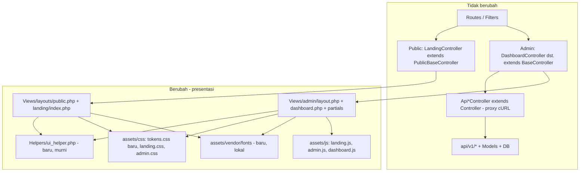
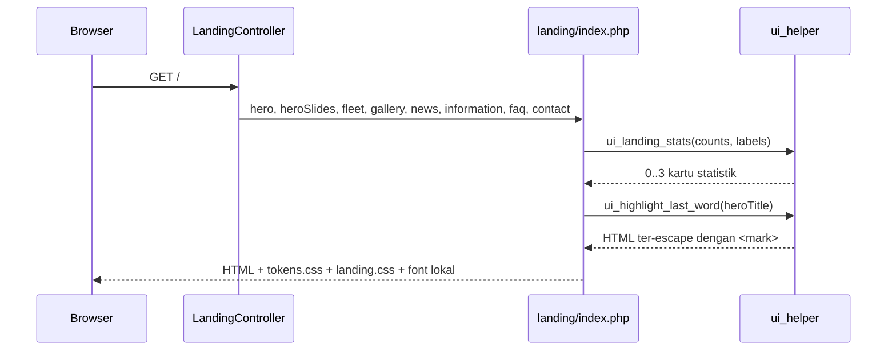
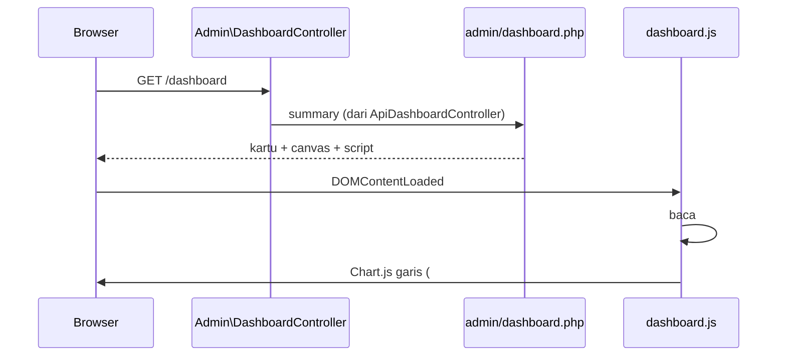

# Dokumen Desain: Redesain UI Berbasis Referensi (Landing "Videmy" & Admin "Acadex")

## Ringkasan

Fitur ini mengganti tampilan (lapisan presentasi saja) situs Wisata & Rental Mobil berbasis CodeIgniter 4.7:

- **Landing publik** mengikuti sistem visual Referensi B (Videmy): latar gradasi biru muda ke putih, kartu-kartu besar bersudut membulat (16-24px), navbar pil minimalis, hero berjudul besar dengan kartu media bergaya jendela browser, baris statistik 3 kartu (kartu pertama charcoal gelap), kartu potret tinggi untuk armada, aksen lime (#e6f542) dan font geometris modern (Plus Jakarta Sans, dibundel lokal).
- **Admin** mengikuti sistem visual Referensi A (Acadex): latar biru dengan bingkai aplikasi putih membulat, sidebar putih dengan kartu profil dan navigasi primer/sekunder, header judul besar + tanggal, kartu statistik dengan tombol panah, kartu grafik (garis, batang, donat) via Chart.js, kartu daftar (berita terbaru, referrer teratas, armada teratas). Font Figtree (dibundel lokal), biru primer #1f5fd0, hijau sekunder #2e9e6b.

Perubahan **hanya** menyentuh view, CSS, JS presentasi, satu helper view baru, aset font lokal, dan tes. Tidak ada perubahan pada route, controller, model, API `api/v1/*`, skema database, maupun kontrak data. Seluruh id, atribut `data-*`, kelas penanda yang dipakai JS/tes, aksesibilitas, tiga bahasa (en/id/ms), dan aset lokal tanpa CDN dipertahankan.

Keputusan pemetaan domain (Videmy -> wisata/rental):

| Elemen referensi | Pemetaan di situs |
|---|---|
| Hero + kartu media "Play Demo" | Hero dari `hero.title/subtitle` + kartu media (carousel `heroSlides` atau placeholder gradasi). Pil lime **"Lihat Armada"** (anchor `#fleet`); tombol WhatsApp tetap `.btn-wa`. Bila carousel punya >1 slide, pil lime kedua berfungsi sebagai tombol Jeda/Putar (WCAG 2.2.2). |
| Baris statistik 50K+/800+/150+ | Dihitung dari data nyata yang sudah ada di view: jumlah armada, galeri, berita, informasi, FAQ. Hanya hitungan > 0 yang tampil, maksimal 3 kartu; jika semua 0, baris disembunyikan. Tidak ada angka karangan ("happy customers" tidak ada di data, jadi tidak ditampilkan). |
| "Meet Your Mentors" (potret) | **Armada Kami**: kartu potret tinggi (rasio 4:5) dalam rel horizontal ber-scroll-snap di mobile, grid 3 kolom di desktop. Chip lime "Siap dipesan" hanya jika tautan WhatsApp ada. |
| Galeri | Grid membulat, caption di overlay gradasi. |
| Success Stories (testimoni) | **Tidak ada data testimoni** -> tidak dibuat bagian baru. Gaya kartu ini dipakai ulang untuk **Berita**: berita terbaru jadi kartu fitur gelap (teks di atas gradasi), sisanya kartu putih. |
| Flexible Plans (harga) | **Tidak ada data harga** -> tidak dibuat bagian baru. Gaya kartu off-white + daftar centang dipakai ulang untuk **Informasi**. |
| Learning Paths (chip filter) | Tidak ada kategori -> chip filter tidak dibuat. Chip hanya untuk label turunan data nyata. |
| FAQ | Accordion Bootstrap yang sama, restyle membulat. |
| Kontak | Kartu charcoal besar dengan CTA WhatsApp lime. |

## Arsitektur

Arsitektur tiga tingkat tetap. Redesain hanya berada di lapisan View (kotak abu-abu pada diagram).



Alur render halaman tidak berubah: controller menyiapkan array, view merender. View hanya menambahkan `helper('ui')` untuk fungsi murni (tanpa I/O).

### Diagram urutan: render landing



### Diagram urutan: dashboard admin



## Token Desain

File baru `public/assets/css/tokens.css` dimuat oleh kedua layout sebelum `landing.css` / `admin.css`. Komponen hanya memakai `var(--token)`; tidak ada warna heksadesimal literal di luar `tokens.css` dan konfigurasi chart.

```css
/* tokens.css — lokal, tanpa CDN */
@font-face { font-family:"Plus Jakarta Sans"; src:url("../vendor/fonts/plus-jakarta-sans/PlusJakartaSans-latin-wght.woff2") format("woff2"); font-weight:300 800; font-style:normal; font-display:swap; }
@font-face { font-family:"Figtree"; src:url("../vendor/fonts/figtree/Figtree-latin-wght.woff2") format("woff2"); font-weight:300 900; font-style:normal; font-display:swap; }

:root {
  /* Netral */
  --c-ink:#2d2d30;          /* charcoal: teks & kartu gelap */
  --c-text:#1f2430;
  --c-muted:#5b6472;        /* >= 5.9:1 di putih */
  --c-surface:#ffffff;
  --c-surface-2:#f6f7f9;    /* off-white */
  --c-border:#e4e7ec;

  /* Landing (Videmy) */
  --lp-sky-top:#dbe9fb;     /* ujung atas gradasi */
  --lp-lime:#e6f542;        /* hanya sebagai LATAR; teks di atasnya --c-ink */
  --lp-lime-ink:#2d2d30;
  --lp-link:#1f5fd0;

  /* Admin (Acadex) */
  --ad-primary:#1f5fd0;     /* teks/ikon biru di putih: 5.8:1 */
  --ad-primary-soft:#e8f0fd;
  --ad-backdrop:#1f5fd0;
  --ad-green:#2e9e6b;       /* hanya isi chart / elemen non-teks */
  --ad-green-text:#1f7a52;  /* untuk teks hijau: 5.3:1 di putih */
  --ad-danger:#b00020;

  /* Fokus */
  --focus-ring:#1f5fd0;     /* permukaan terang, >= 3:1 */
  --focus-ring-on-dark:#e6f542;

  /* Radius */
  --r-sm:8px; --r-md:12px; --r-lg:16px; --r-xl:24px; --r-pill:999px;

  /* Bayangan */
  --sh-sm:0 1px 2px rgba(16,24,40,.06);
  --sh-md:0 8px 24px rgba(16,24,40,.08);
  --sh-lg:0 24px 60px rgba(16,24,40,.14);

  /* Tipografi */
  --font-landing:"Plus Jakarta Sans", system-ui, -apple-system, "Segoe UI", Roboto, sans-serif;
  --font-admin:"Figtree", system-ui, -apple-system, "Segoe UI", Roboto, sans-serif;
  --fs-display:clamp(2.1rem, 6vw, 4rem);   /* judul hero */
  --fs-h2:clamp(1.6rem, 3.5vw, 2.5rem);
  --fs-stat:clamp(2.5rem, 7vw, 4.5rem);
  --fs-body:1rem; --fs-small:.875rem;

  /* Spasi bagian */
  --space-section:clamp(3rem, 8vw, 6rem);
}
```

Matriks pasangan kontras (diverifikasi oleh tes, lihat Strategi Pengujian). Teks normal wajib >= 4.5:1; elemen UI/ikon/fokus >= 3:1.

| Latar | Teks | Perkiraan rasio | Ambang |
|---|---|---|---|
| `--c-surface` | `--c-text` | >= 14:1 | 4.5 |
| `--c-surface` / `--c-surface-2` | `--c-muted` | ~6.0 / ~5.5 | 4.5 |
| `--lp-lime` | `--lp-lime-ink` | ~10:1 | 4.5 |
| `--c-ink` | `#ffffff` | ~13:1 | 4.5 |
| `--ad-primary` | `#ffffff` | ~5.8:1 | 4.5 |
| `--c-surface` | `--ad-primary` | ~5.8:1 | 4.5 |
| `--ad-primary-soft` | `--ad-primary` | ~5.0:1 | 4.5 |
| `--c-surface` | `--ad-green-text` | ~5.3:1 | 4.5 |
| `--c-surface` | `--focus-ring` | ~5.8:1 | 3 |
| `--c-ink` | `--focus-ring-on-dark` | ~10:1 | 3 |

Catatan: `--lp-lime` dan `--ad-green` **tidak** boleh dipakai sebagai warna teks di latar putih (kontras < 4.5:1).

## Komponen dan Antarmuka

### A. Landing (mobile-first)

Breakpoint mengikuti Bootstrap: base <576, `sm` 576, `md` 768, `lg` 992, `xl` 1200. Gaya dasar untuk mobile; `@media (min-width: ...)` menambah.

| Komponen | Kelas utama | Perilaku |
|---|---|---|
| Latar halaman | `body.public-body` | `background: linear-gradient(180deg, var(--lp-sky-top) 0, var(--c-surface-2) 560px, var(--c-surface) 100%) no-repeat`; `font-family: var(--font-landing)` |
| Navbar pil | `header.site-header.sticky-top > nav.navbar.navbar-expand-lg > .nav-pill` | Kontainer putih, `--r-pill`, `--sh-md`, blur ringan. Logo mark = kotak lime 32px `--r-sm` berisi ikon `bi-compass`. Hamburger `.navbar-toggler` di <lg; menu collapse tetap `#site-nav`. Dropdown bahasa tetap `ul.lang-selector` berisi 3 tautan `lang/en|id|ms`. |
| Hero intro | `.hero-intro` | `h1#hero-title` (satu-satunya h1), bobot 500, `letter-spacing:-.02em`, kata terakhir dibungkus `<mark class="hl">` (latar lime). Subjudul muted. Baris CTA: `.btn-wa` (pil charcoal di mobile, hijau `--accent` aksesibel di desktop) dan tautan sekunder. |
| Pil kepercayaan | `.trust-pill` | Hanya jika jumlah armada > 0: "{n} armada siap jalan". Dirender dari data nyata. |
| Kartu media | `.hero-media` > `.browser-frame` | Bilah atas dengan 3 titik dekoratif (`aria-hidden`). Isi: carousel `#hero-carousel` bila `heroSlides` >0, jika tidak `<div class="hero">` placeholder gradasi. Rasio 16:9 (mobile 4:3), `--r-xl`, `--sh-lg`. |
| Pil lime | `.btn-lime` | "Lihat Armada" -> `#fleet`. Teks `--lp-lime-ink`. Bila slide >1, `.btn-lime[data-hero-toggle]` jeda/putar carousel dengan ikon `bi-pause-fill`/`bi-play-fill` dan `aria-pressed`. |
| Baris statistik | `.stats-row > .stat-card(.stat-card--dark)` | Hasil `ui_landing_stats()`. Kartu pertama `--c-ink` dengan angka putih `--fs-stat`; lainnya putih. Grid 1 kolom -> 3 kolom di `md`. |
| Bagian | `section.section > .container > .section-card` | Judul h2 tengah + subjudul muted; kartu pembungkus `--r-xl`, `--sh-sm`. Id bagian tidak berubah. |
| Kartu armada | `.fleet-rail > .fleet-card` | Rel flex ber-`scroll-snap-type:x mandatory` di <lg, grid 3 kolom di lg. Gambar `aspect-ratio:4/5`, overlay gradasi, nama, deskripsi 2 baris, chip `.chip-lime`, tombol `.btn-wa` dengan semua atribut `data-track-booking`, `data-fleet-id`, `data-fleet-name` tetap. Rel `tabindex="0"` + `aria-label` agar bisa di-scroll keyboard. |
| Galeri | `.gallery-grid` | Grid 2 -> 3 kolom, `figure` + `figcaption` di overlay. |
| Berita | `.news-feature` + `.news-card` | Item pertama kartu gelap berpakaian "kutipan"; sisanya kartu putih. Tanggal tetap `.card-date`. |
| Informasi | `.info-card` | Latar off-white, ikon `bi-check-circle-fill`, judul + isi. |
| FAQ | `.accordion` (kelas persis) | Item membulat `--r-lg`; tombol tetap `.accordion-button.faq-question`. |
| Kontak | `.contact-card` | Kartu `--c-ink`, teks putih, CTA WhatsApp lime. |
| Footer | `.site-footer` | Kartu gelap membulat, di dalam container. |
| WA mengambang | `a.wa-float` (kelas persis) | Tidak berubah fungsinya. |

Antarmuka helper murni `app/Helpers/ui_helper.php` (dimuat dengan `helper('ui')`):

```php
/**
 * @param array<string,int> $counts  kunci: fleet|gallery|news|information|faq
 * @param array<string,string> $labels  label per kunci (sudah per bahasa)
 * @return list<array{key:string,value:int,label:string,dark:bool}>
 */
function ui_landing_stats(array $counts, array $labels): array;

/** Escape lalu bungkus kata terakhir dengan <mark class="hl">. Mengembalikan HTML aman. */
function ui_highlight_last_word(string $text): string;

/** 1-2 huruf kapital dari nama; fallback "A". Tanpa markup. */
function ui_initials(string $name): string;

/** Tandai item nav aktif: Dashboard cocok persis, lainnya cocok prefix segmen. */
function ui_nav_is_active(string $requestPath, string $itemPath): bool;

/** Tanggal header admin, mis. "Monday, 12 May 2025" (bahasa Inggris, sesuai UI admin). */
function ui_admin_date(\DateTimeInterface $now): string;
```

### B. Admin

| Komponen | Kelas utama | Perilaku |
|---|---|---|
| Latar | `body.admin-body` | `background: var(--ad-backdrop)`; padding 16px di >=lg, 0 di <lg. `font-family: var(--font-admin)`. |
| Bingkai aplikasi | `.admin-frame.d-lg-flex` | Putih, `--r-xl`, `--sh-lg`, `min-height: calc(100vh - 2rem)`; di <lg radius 0. Membungkus sidebar dan konten (menggantikan `.admin-shell`). |
| Sidebar | `aside#adminSidebar.offcanvas-lg.offcanvas-start.admin-sidebar` | Lebar 15rem (240px), putih. Di <lg menjadi offcanvas (id, `offcanvas-lg`, `aria-labelledby="adminSidebarLabel"` dipertahankan). |
| Brand | `.admin-brand` | Logo mark biru + "Travel Admin". |
| Kartu profil | `.profile-card` (`button.dropdown-toggle`) | Avatar bulat berisi `ui_initials(username)`, nama (session `admin_username`), peran "Admin", chevron. Menu dropdown: Site config, Sign out. |
| Nav primer | `ul.admin-nav` | Dashboard, Information, News, Fleet, FAQ, Gallery; ikon outline. Aktif: teks+ikon biru, latar `--ad-primary-soft`, `aria-current="page"`. |
| Divider + nav sekunder | `ul.admin-nav.admin-nav--secondary` | Site config, View website (`/`, tab baru, `rel="noopener"`), Sign out (`signout`). |
| Header halaman | `partials/page_header.php` | `h1` besar tebal + subjudul tanggal (`ui_admin_date`), `.page-header__actions` slot. Dipakai dashboard dan `list_table`. Topbar mobile: tombol hamburger + brand (tampil <lg). |
| Kartu statistik | `.stat-card` | Label kecil muted, angka `class="fs-3 fw-semibold"` (token string dipertahankan untuk tes), tile ikon biru-muda persegi 40px berisi panah `bi-arrow-up-right`. Delapan kartu pengunjung/booking: tile dekoratif (`aria-hidden`). Lima kartu konten: tile berupa tautan ke `admin/<entitas>` dengan `aria-label` "Open {Entity}". |
| Kartu chart | `.chart-card` | Header judul + kontrol kanan (select rentang pada chart garis). Tinggi tetap agar tidak CLS. |
| Kartu donat | `.donut-card` | Canvas + `.donut-center` (total) + `ul.donut-legend` (titik warna, label, persen, jumlah). |
| Kartu daftar | `.list-card` | Referrer teratas & armada teratas: `<ol>` dengan nama, hitungan, bilah proporsi. Berita terbaru: tile ikon biru-muda, judul tebal, badge tanggal biru, relatif. Login terakhir: kartu kecil. |
| Tabel/form existing | `.admin-table`, `.lang-field`, dst. | Hanya restyle (warna, radius, font); markup dan hook `admin.js` tidak diubah. |
| Halaman signin | `signin.php` | Kartu putih membulat di atas latar biru. |

### C. Dashboard.js (kontrak lama + tambahan aditif)

Kontrak lama tetap: `#dashboard-data` (JSON), `#chart-daily`, `#chart-language`, `#chart-device`, `#chart-*-empty`, envelope `{data}` atau objek polos, fallback saat `window.Chart` hilang.

Tambahan aditif:

```js
// Hook baru (opsional; JS wajib toleran jika tidak ada)
//   #chart-weekly + #chart-weekly-empty   -> batang berkelompok 7 hari (page views vs unique)
//   #daily-range (select 7|14|30)         -> memotong data harian client-side
//   #legend-language, #legend-device      -> <ul> legenda; #total-language, #total-device -> angka tengah
const THEME = {            // satu-satunya tempat warna di JS; selaras tokens.css
  primary: '#1f5fd0', green: '#2e9e6b', palette: ['#1f5fd0','#2e9e6b','#f2a93b','#7a5af8','#e5484d','#20b2aa'],
  tooltipBg: '#111418'
};
function sliceDaily(rows, days) { return rows.slice(-days); }       // murni
function areaGradient(ctx, area) { /* gradasi hijau -> transparan */ }
```

Garis `#chart-daily`: garis hijau halus (`tension .4`), area gradasi, titik penanda, tooltip hitam dengan panduan vertikal putus-putus (plugin inline kecil). Batang `#chart-weekly`: dua dataset (hijau & biru), legenda. Donat: `cutout:'68%'`, total di tengah via elemen HTML, legenda HTML. Animasi dimatikan saat `matchMedia('(prefers-reduced-motion: reduce)')`.

## Model Data

Tidak ada model data baru dan tidak ada perubahan skema. Struktur yang dipakai view (sudah ada):

```php
// Landing (dari LandingController)
$hero = ['title'=>string,'subtitle'=>string]; $heroSlides = [['image'=>url,'alt'=>string]]; // maks 5
$fleet = [['id','name','description','image','whatsapp'|null]]; $gallery = [['image','caption']];
$news = [['title','body','publish_date']]; $information = [['title','body']]; $faq = [['question','answer']];
$contact = ['body','email','address','whatsapp'|null];

// Admin dashboard (dari ApiDashboardController)
$summary['data'] = ['visitors'=>[total,unique_today,unique_7d,unique_30d,page_views],
  'bookings'=>[total,last_7d,last_30d,top_fleet[]], 'content'=>[fleet|news|information|faq|gallery=>[published,draft]],
  'referrers'=>[], 'daily'=>[['date','page_views','unique']], 'languages'=>{k:{count,percent}}, 'devices'=>{k:{count,percent}},
  'latest_news'=>[], 'last_admin_login'=>string|null, 'whatsapp_configured'=>bool];
```

Label i18n baru landing (ditambahkan ke `$labelsByLang` di `landing/index.php` dan `$layoutLabels` di `layouts/public.php`; ketiga bahasa wajib lengkap):

| Kunci | en | id | ms |
|---|---|---|---|
| `viewFleet` | View Fleet | Lihat Armada | Lihat Armada |
| `readyToBook` | Ready to book | Siap dipesan | Sedia ditempah |
| `trust` | {n} vehicles ready to go | {n} armada siap jalan | {n} kenderaan sedia bergerak |
| `pause` / `play` | Pause slideshow / Play slideshow | Jeda slideshow / Putar slideshow | Jeda tayangan / Main tayangan |
| `statFleet` | Vehicles in our fleet | Armada kami | Kenderaan dalam armada |
| `statGallery` | Moments captured | Momen terabadi | Detik diabadikan |
| `statNews` | News & updates | Berita & kabar | Berita & kemas kini |
| `statInformation` | Helpful guides | Informasi berguna | Maklumat berguna |
| `statFaq` | Questions answered | Pertanyaan terjawab | Soalan dijawab |
| `moreFleetSubtitle` | Pick the ride that fits your trip | Pilih kendaraan yang pas untuk perjalananmu | Pilih kenderaan yang sesuai untuk perjalanan anda |

Teks kosong (`emptyFleet`, `emptyNews`, dll.) dan `Book via WhatsApp` **tidak diubah** karena dipakai tes.

## Pseudokode Algoritmik

### ui_landing_stats

```pascal
ALGORITHM ui_landing_stats(counts, labels)
INPUT: counts map kunci->int, labels map kunci->string
OUTPUT: daftar kartu (maks 3)

BEGIN
  priority <- [fleet, gallery, news, information, faq]
  result <- []
  FOR each key IN priority DO
    n <- max(0, intval(counts[key] ?? 0))
    IF n > 0 AND labels[key] exists AND length(result) < 3 THEN
      result.append({key: key, value: n, label: labels[key], dark: (length(result) = 0)})
    END IF
  END FOR
  RETURN result
END
```

**Prasyarat:** `counts` dan `labels` adalah array (boleh kosong).
**Pascakondisi:** panjang hasil <= 3; setiap `value` > 0; urutan mengikuti prioritas; hanya elemen pertama memiliki `dark = true`; hasil kosong bila semua hitungan 0.
**Invarian loop:** `result` selalu berurutan menurut prioritas dan berukuran <= 3.

### ui_highlight_last_word

```pascal
ALGORITHM ui_highlight_last_word(text)
BEGIN
  trimmed <- trim(text)
  IF trimmed = "" THEN RETURN "" END IF
  parts <- split trimmed pada spasi terakhir -> (head, last)
  IF head = "" THEN RETURN "<mark class=hl>" + esc(last) + "</mark>" END IF
  RETURN esc(head) + " <mark class=hl>" + esc(last) + "</mark>"
END
```

**Pascakondisi:** `strip_tags(hasil)` setara `esc(trim(text))` setelah normalisasi spasi; tidak ada HTML dari input yang lolos (selalu di-escape).

### ui_nav_is_active

```pascal
ALGORITHM ui_nav_is_active(requestPath, itemPath)
BEGIN
  r <- trim(requestPath, "/"); i <- trim(itemPath, "/")
  IF i = "dashboard" THEN RETURN r = "dashboard" END IF
  RETURN r = i OR startsWith(r, i + "/")
END
```

**Pascakondisi:** `admin/news` aktif untuk `admin/news` dan `admin/news/create`, tidak untuk `admin/newsletter`.

### Pemasangan chart donat

```pascal
ALGORITHM renderDonut(data, key, canvasId, order)
BEGIN
  counts, percents <- baca dari data[key] mengikuti order (lalu kunci tambahan)
  total <- sum(counts)
  IF total = 0 THEN showEmpty(canvas); RETURN END IF
  hideEmpty(canvas)
  IF sum(percents) = 0 THEN percents <- round(counts / total * 100, 1) END IF
  buat Chart doughnut; tulis total ke #total-<key>; isi legenda #legend-<key>
END
```

**Pascakondisi:** total nol -> canvas disembunyikan dan `#<canvasId>-empty` terlihat; selain itu legenda berisi satu `<li>` per kunci.

## Contoh Penggunaan

```php
// landing/index.php (potongan)
helper('ui');
$stats = ui_landing_stats(
    ['fleet' => count($fleet), 'gallery' => count($gallery), 'news' => count($news),
     'information' => count($information), 'faq' => count($faq)],
    ['fleet' => $t['statFleet'], 'gallery' => $t['statGallery'], 'news' => $t['statNews'],
     'information' => $t['statInformation'], 'faq' => $t['statFaq']]
);
?>
<h1 id="hero-title"><?= ui_highlight_last_word($heroTitle !== '' ? $heroTitle : $t['readyHero']) ?></h1>
<?php if ($stats !== []): ?>
  <div class="stats-row">
    <?php foreach ($stats as $s): ?>
      <div class="stat-card<?= $s['dark'] ? ' stat-card--dark' : '' ?>">
        <div class="stat-card__value"><?= number_format($s['value']) ?></div>
        <div class="stat-card__label"><?= esc($s['label']) ?></div>
      </div>
    <?php endforeach; ?>
  </div>
<?php endif; ?>
```

```php
// admin/layout.php (potongan nav aktif)
<a class="nav-link<?= ui_nav_is_active($path, $item['path']) ? ' active' : '' ?>"
   <?= ui_nav_is_active($path, $item['path']) ? 'aria-current="page"' : '' ?> href="...">
```

## Correctness Properties

*Sebuah properti adalah karakteristik atau perilaku yang harus berlaku untuk semua eksekusi valid sistem; pada dasarnya pernyataan formal tentang apa yang harus dilakukan sistem. Properti menjembatani spesifikasi yang dapat dibaca manusia dengan jaminan kebenaran yang dapat diverifikasi mesin.*

Catatan cakupan: tampilan visual (tata letak, responsif, animasi, konfigurasi Chart.js) tidak cocok untuk pengujian properti dan diuji lewat tes contoh/smoke serta pemeriksaan manual. Properti di bawah hanya untuk logika murni helper dan keluaran view yang bervariasi menurut data.

### Property 1: Statistik landing selalu valid dan terurut

*For any* map hitungan `counts` (nilai bilangan bulat, termasuk nol dan negatif) dan map `labels`, `ui_landing_stats` mengembalikan paling banyak 3 kartu; setiap `value` > 0; urutan kunci mengikuti prioritas fleet, gallery, news, information, faq; hanya kartu pertama yang `dark = true`; dan hasilnya kosong bila tidak ada hitungan positif berlabel.

**Validates: Requirements 4.1, 4.2, 4.3, 4.4, 4.5, 4.6**

### Property 2: Sorotan kata terakhir aman dan menjaga teks

*For any* string `s`, `ui_highlight_last_word(s)` hanya mengandung tag `<mark class="hl">` dan `</mark>`, dan `strip_tags` hasilnya (dengan spasi dinormalkan) sama dengan `esc(trim(s))` yang dinormalkan; untuk `s` berisi spasi saja hasilnya string kosong.

**Validates: Requirements 3.2, 13.1, 13.2, 13.3, 13.4**

### Property 3: Inisial avatar selalu pendek dan aman

*For any* string nama, `ui_initials` mengembalikan 1 atau 2 karakter huruf kapital tanpa karakter `<`, `>`, `&`, `"`, `'`; jika nama tidak memuat huruf yang dapat dipakai, hasilnya `"A"`.

**Validates: Requirements 7.4, 7.8, 13.5, 13.6**

### Property 4: Item navigasi aktif konsisten

*For any* path permintaan, daftar item navigasi admin menghasilkan paling banyak satu item aktif menurut `ui_nav_is_active`; `dashboard` hanya aktif untuk path persis `dashboard`; item lain aktif untuk path sama atau path yang diawali `item/`, dan tidak aktif untuk path yang hanya berawalan teks sama tanpa pemisah (misalnya `admin/newsletter` untuk `admin/news`).

**Validates: Requirements 7.7, 13.7, 13.8**

### Property 5: Format tanggal header admin dapat di-parse

*For any* tanggal valid, `ui_admin_date` menghasilkan string berpola `NamaHari, dd NamaBulan yyyy` berbahasa Inggris yang, bila di-parse dengan format `l, d F Y`, menghasilkan tanggal kalender yang sama.

**Validates: Requirements 7.9, 13.9**

### Property 6: Pasangan warna token memenuhi kontras

*For any* pasangan (latar, teks/UI, ambang) pada matriks kontras yang dideklarasikan, rasio kontras WCAG yang dihitung dari nilai heksadesimal di `tokens.css` sama atau lebih besar dari ambang (4.5 untuk teks, 3 untuk fokus/UI).

**Validates: Requirements 11.1, 11.2**

### Property 7: Struktur landing stabil untuk data apa pun

*For any* data landing (hero, 0-8 slide, daftar fleet/gallery/news/information/faq/contact acak termasuk kosong) dan bahasa yang didukung, HTML hasil render memuat tepat satu `<h1`, semua id bagian (`top, about, fleet, gallery, news, information, faq, contact`), jumlah `class="carousel-item` sama dengan `min(slide, 5)`, kontrol carousel/indikator/`data-hero-toggle` hanya jika slide > 1 dengan target `#hero-carousel`, `class="hero"` hanya jika slide = 0, dan Stats_Row hadir jika dan hanya jika `ui_landing_stats` tidak kosong.

**Validates: Requirements 3.1, 3.4, 3.5, 3.6, 3.7, 3.9, 4.6, 5.1, 11.7**

### Property 8: Elemen WhatsApp hanya muncul bila tautan ada

*For any* data landing dan *for any* armada, tombol `Book via WhatsApp` (dengan `data-track-booking`, `data-fleet-id`, `data-fleet-name`) dan chip "Siap dipesan" dirender jika dan hanya jika tautan WhatsApp armada tidak null; tombol hero `.btn-wa`, tombol kontak, dan `wa-float` dirender jika dan hanya jika tautan kontak tidak null.

**Validates: Requirements 2.6, 2.7, 3.10, 5.6, 5.7**

### Property 9: Semua teks data landing ter-escape

*For any* string data (judul hero, nama armada, caption, judul/isi berita, pertanyaan FAQ, alamat, tautan WhatsApp) yang berisi karakter markup atau tanda kutip, HTML hasil render tidak memuat bentuk mentah string tersebut sebagai tag/atribut yang dapat dieksekusi (hanya bentuk ter-escape).

**Validates: Requirements 5.15, 3.10**

### Property 10: Label tiga bahasa lengkap dan fallback ke en

*For any* kunci label pada kumpulan label landing dan layout publik, kunci tersebut ada dan tidak kosong pada `en`, `id`, dan `ms`; dan *for any* string bahasa yang tidak didukung, halaman dirender dengan label `en`.

**Validates: Requirements 6.1, 6.2, 6.3**

### Property 11: Dashboard memetakan data ringkasan ke hook dan keadaan kosong

*For any* ringkasan parsial atau kosong (kunci hilang, nilai non-numerik, daftar kosong), render dashboard memuat delapan elemen `fs-3 fw-semibold` yang nilainya sama dengan data (atau 0), semua Dashboard_Hooks canvas dan `#chart-*-empty` plus `#chart-weekly`, `#dashboard-empty` jika dan hanya jika tidak ada data pengunjung/pemesanan, `#whatsapp-warning` jika dan hanya jika `whatsapp_configured` salah, dan teks kosong tiap List_Card jika dan hanya jika daftarnya kosong.

**Validates: Requirements 8.1, 8.4, 8.5, 8.12, 8.13, 8.14, 8.15, 11.7**

### Property 12: JSON dashboard bersifat round trip

*For any* array `data` ringkasan (termasuk string unicode, tanda kutip, `<`, `&`), isi `<script id="dashboard-data">` hasil render valid sebagai JSON dan, setelah di-decode, setara dengan `data` yang diberikan.

**Validates: Requirements 8.17**

## Struktur Hook yang Dipertahankan

Hook berikut **tidak boleh berubah** (dipakai JS atau tes yang ada):

| Area | Hook |
|---|---|
| Layout publik | `skip-link` -> `#main`; `main#main`; `navbar navbar-expand-lg`; `.navbar-toggler` + `#site-nav`; `ul.lang-selector` dengan 3 tautan `lang/en|id|ms`; `a.wa-float` (kelas persis); hanya aset lokal (`/assets/vendor/bootstrap/...`, `bootstrap-icons`) |
| Landing | id bagian `top, about, fleet, gallery, news, information, faq, contact`; `h1#hero-title` tepat satu; `class="hero"` persis saat tanpa slide; `class="carousel-item"` satu per slide; `data-bs-ride="carousel"`, `data-bs-interval="5000"`; `carousel-indicators`, `carousel-control-prev/next`, `data-bs-slide-to` hanya jika slide >1; `class="accordion"`, `class="accordion-item"`, `data-bs-toggle="collapse" data-bs-target="#faq-a-N"`, `.faq-question`; `.btn-wa` + `data-track-booking`, `data-fleet-id`, `data-fleet-name`; teks `Book via WhatsApp`; pesan kosong lokal; escape atribut WhatsApp |
| Admin layout | meta `csrf-*`, `base-url`, `robots noindex`; `#adminSidebar.offcanvas-lg`; `#adminSidebarLabel`; `#toast-region`; link `signout`, `dashboard`, `admin/*` |
| Dashboard | `#dashboard-data`, `#dashboard-empty`, `#whatsapp-warning`, `canvas#chart-daily/#chart-language/#chart-device`, `#chart-*-empty`, 8x `fs-3 fw-semibold`, 5x `badge text-bg-success` ("Published N") dan "Draft N", teks kosong ("No referrer data yet.", "No booking clicks yet.", "No news yet.", "No login recorded."), tepat 1 referensi `chart.umd.min.js` lokal |
| Daftar/form admin | `data-admin-list`, `data-entity`, `data-page`, `th[data-key]`, `#list-status`, `[data-admin-pager]`, `[data-page-prev|next|info]`, `.table-responsive`, `data-lang-tab/panel/field`, `data-error-for`, `#form-summary`, `.invalid`, `.field-error` |

Satu-satunya penyesuaian hook yang disengaja: target kontrol carousel berpindah dari `#top` ke `#hero-carousel` karena `#top` kini membungkus intro + kartu media. Id `top` tetap ada sebagai anchor bagian hero. Tidak ada tes yang saat ini mengacu pada `data-bs-target="#top"`; tes baru memverifikasi target baru.

## Penanganan Error

| Skenario | Kondisi | Respons | Pemulihan |
|---|---|---|---|
| Font lokal gagal dimuat | File woff2 404/diblokir | `font-display: swap` + tumpukan font sistem; tata letak tetap valid | Tidak ada tindakan; tidak ada request eksternal |
| Chart.js gagal dimuat | `window.Chart` bukan fungsi | `dashboard.js` menampilkan `#chart-*-empty` (kontrak lama) dan legenda kosong | Kartu angka & daftar tetap berfungsi |
| `#dashboard-data` rusak | JSON invalid | `readData()` mengembalikan `{}`; semua chart kosong | Kartu server-side tetap tampil nol |
| Elemen hook baru hilang | `#chart-weekly`, `#daily-range`, legenda tidak ada | JS melewati fitur terkait tanpa melempar | Dashboard lama tetap jalan |
| Data landing kosong | Seksi tanpa data | Pesan kosong lokal yang sama; baris statistik disembunyikan jika semua 0 | - |
| Gambar armada/galeri gagal | `onerror` | Ganti ke `fleet-placeholder.svg` (perilaku lama) | - |
| Session admin tanpa username | `admin_username` kosong | Nama tampil "Admin", inisial "A" | - |
| `prefers-reduced-motion` | Preferensi sistem aktif | Smooth scroll, transisi carousel, animasi chart dimatikan | - |

## Aksesibilitas

- Kontras: seluruh pasangan di matriks >= 4.5:1 (teks) / 3:1 (UI & fokus). Lime dan hijau `#2e9e6b` hanya sebagai latar/isi, bukan teks pada putih.
- Fokus: `:focus-visible { outline: 3px solid var(--focus-ring); outline-offset: 2px }`; pada permukaan gelap (`.stat-card--dark`, `.contact-card`, `.site-footer`, kartu gelap) memakai `--focus-ring-on-dark`. Pengganti nilai amber lama (#ffbf47 ≈ 1.8:1 di putih).
- Target sentuh >= 44x44px untuk tombol ikon, hamburger, tile panah-tautan.
- Carousel otomatis dapat dijeda lewat `.btn-lime[data-hero-toggle]` (WCAG 2.2.2) dan berhenti saat hover/fokus (perilaku Bootstrap yang ada).
- Dekorasi (titik jendela browser, ikon, tile panah non-tautan) `aria-hidden="true"`; rel armada horizontal fokusable dan berlabel.
- Chart tetap `role="img"` + `aria-label`; legenda HTML menyajikan angka yang sama sebagai teks.
- `prefers-reduced-motion: reduce` mematikan `scroll-behavior`, transisi, animasi chart.
- Struktur heading: satu h1 per halaman; urutan h2/h3 tidak melompat.
- Catatan: kepatuhan WCAG penuh tetap memerlukan uji manual dengan teknologi bantu dan tinjauan ahli.

## Strategi Pengujian

### Pengujian unit (contoh) — memperbarui yang ada

- `LandingViewTest`: seluruh asersi lama tetap lulus. Tambah: target kontrol carousel `#hero-carousel`; tepat satu `<h1`; `<mark class="hl">` ada di dalam h1; baris statistik absen saat semua data kosong; chip "Ready to book" hanya saat WhatsApp ada.
- `DashboardViewTest`: asersi lama tetap lulus (token string dipertahankan). Tambah: `canvas id="chart-weekly"`, `chart-weekly-empty`, `donut-legend`, `aria-label="Open Fleet"` pada kartu konten.
- `VendorAssetsLayoutsSmokeTest`: tambah keberadaan `tokens.css` pada kedua layout, berkas font woff2 tidak kosong, nol `https://cdn.`/`jsdelivr`/`fonts.googleapis`.
- `AdminViewsTest`: tambah `aria-current="page"` pada nav aktif dan kartu profil memuat inisial.
- Smoke baru: layout admin saat belum login (signin) tetap dirender di atas latar biru tanpa sidebar.

### Pengujian properti

Library: **Eris** (`giorgiosironi/eris`, sudah terpasang), minimum 100 iterasi per properti, tag `// Feature: ui-redesign-reference, Property {n}: {teks}`. Properti didefinisikan di bagian Correctness Properties.

### Pengujian integrasi / manual

- Render `LandingController` dan `Admin\DashboardController` lewat tes yang sudah ada (`LandingIntegrationTest`), pastikan status 200 dan hook utama ada.
- Pemeriksaan visual manual pada lebar 360, 768, 1024, 1440 (tidak diotomatisasi; UI rendering tidak cocok untuk PBT).

## Pertimbangan Kinerja

- Hanya dua file font variabel (subset latin, perkiraan <= 60KB masing-masing), `font-display: swap`, `<link rel="preload" as="font" type="font/woff2" crossorigin>` untuk font halaman terkait.
- Gambar tetap `loading="lazy"` kecuali slide pertama; `aspect-ratio` pada semua kartu gambar untuk mencegah CLS; tinggi tetap pada kartu chart.
- `landing.css`/`admin.css` tetap satu berkas per sisi; `tokens.css` kecil (<4KB) dan di-cache.
- `backdrop-filter` hanya pada navbar dan punya fallback latar solid.

## Pertimbangan Keamanan

- Semua keluaran tetap melalui `esc()`; `ui_highlight_last_word` meng-escape sebelum membungkus `<mark>`.
- Tidak ada skrip/sumber eksternal: font, ikon, dan Chart.js lokal (Persyaratan 10.1, 10.2, 12.26 spec asli).
- Tautan eksternal baru ("View website", WhatsApp) memakai `rel="noopener"`.
- Tidak ada perubahan pada CSRF meta, filter autentikasi, atau noindex admin.
- Lisensi font: Plus Jakarta Sans dan Figtree berlisensi SIL OFL 1.1; sertakan berkas lisensi di folder font.

## Berkas yang Berubah

| Berkas | Perubahan |
|---|---|
| `app/Views/layouts/public.php` | Navbar pil, tautan `tokens.css`, preload font, label baru, footer kartu |
| `app/Views/landing/index.php` | Hero intro + kartu media, baris statistik, restyle semua bagian, label baru |
| `app/Views/admin/layout.php` | Latar biru + `.admin-frame`, sidebar profil + nav primer/sekunder, topbar mobile |
| `app/Views/admin/dashboard.php` | Header, kartu statistik panah, kartu chart/donat/daftar, hook `#chart-weekly` |
| `app/Views/admin/signin.php`, `admin/partials/list_table.php` | Restyle + `page_header` |
| `app/Views/admin/partials/page_header.php` | **Baru** |
| `app/Helpers/ui_helper.php` | **Baru** (fungsi murni) |
| `public/assets/css/tokens.css` | **Baru** |
| `public/assets/css/landing.css`, `admin.css` | Ditulis ulang di atas token |
| `public/assets/js/landing.js` | Toggle jeda/putar carousel; scroll rel; hapus kode `.nav-toggle` lama bila tak terpakai |
| `public/assets/js/dashboard.js` | Chart garis gradasi, batang, donat + legenda, range select (aditif) |
| `public/assets/js/admin.js` | Tidak berubah kecuali bila ditemukan konflik kelas |
| `public/assets/vendor/fonts/**`, `vendor/README.md` | **Baru** / diperbarui (font + lisensi + sumber unduhan) |
| `tests/unit/*` | Perbarui dan tambah tes (lihat strategi) |

## Yang Tidak Boleh Berubah

- Route, filter, controller (termasuk arsitektur: `Api*Controller extends Controller`, controller halaman extends `BaseController`/`PublicBaseController`, deklarasi properti PHP 8.2), model, migrasi, `api/v1/*`, skema database.
- Kontrak data view (nama dan bentuk array) dan kontrak proxy.
- Hook pada tabel "Struktur Hook yang Dipertahankan" (kecuali penyesuaian target carousel yang tercatat).
- Tiga bahasa dengan fallback ke `en`; UI admin tetap berbahasa Inggris.
- Tanpa CDN; hanya aset lokal.

## Dependensi

- Bootstrap 5.3.8, Bootstrap Icons 1.11.4, Chart.js 4.6.1 (lokal, sudah ada).
- Font baru (lokal, OFL): Plus Jakarta Sans variable (latin), Figtree variable (latin). Diunduh satu kali saat pengembangan (misalnya dari paket Fontsource via npm CDN) lalu di-commit; tidak ada permintaan CDN saat runtime. Sumber dan versi dicatat di `public/assets/vendor/README.md`.
- Dev: PHPUnit + Eris (sudah ada).
